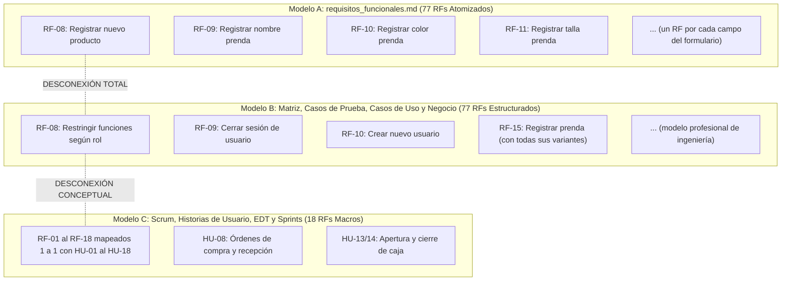

# 📊 INFORME DE ANÁLISIS INTEGRAL, VERIFICACIÓN DE COHERENCIA Y PLAN DE MEJORAS
**Proyecto:** Sistema de Gestión Comercial — Tienda de Ropa para Varón (SYSELL Web v2.0)  
**Equipo:** Pollitos Design — ESIS UNJBG (Ingeniería de Software I)  
**Fecha de Auditoría:** Octubre 2026  
**Documento de Salida:** Auditoría Técnica y Recomendaciones de Ingeniería de Software  

---

## 📌 1. Resumen Ejecutivo y Diagnóstico Global

El presente informe constituye una **auditoría completa de ingeniería de software** realizada sobre el repositorio del proyecto. Se evaluó la consistencia metodológica, técnica, estructural y documental de los **24 archivos de especificación (~5,840 líneas de documentación)**, contrastando la trazabilidad entre el negocio, requisitos funcionales/no funcionales, casos de uso, diagramas DFD, modelo de base de datos relacional, diagramas de secuencia, casos de prueba (IEEE 829), product backlog, sprints, análisis EDT y acuerdos de equipo.

### 🌟 Fortalezas Destacadas del Repositorio
1. **Rigor Metodológico y Profundidad:** El repositorio no es un simple resumen superficial; contiene artefactos de ingeniería avanzados (IEEE 829, DFD niveles 0-2 balanceados, Clean Architecture + CQRS, WBS optimizada y Working Agreement formal).
2. **Modelado Visual Completo:** Todos los diagramas cuentan con sus archivos fuente editables (`.puml`, `.mmd`) y sus versiones renderizadas (`.png`).
3. **Enfoque de Negocio Real:** La delimitación de 2 locales físicos, control estricto de catálogos maestros y tickets digitales internos (desligados de SUNAT) responde a una solución pragmática y realista para una tienda física de indumentaria masculina.

### ⚠️ Calificación de Coherencia Global: `7.5 / 10` (Notable pero con Desalineaciones Críticas)
A pesar de su alta calidad técnica individual, el repositorio presenta **desconexiones severas de sincronización entre documentos creados en distintas etapas**, especialmente entre la lista de requisitos funcionales, la matriz de trazabilidad y el backlog ágil.

---

## 🔍 2. Cuadro de Hallazgos Críticos de Incoherencia

| N° | Hallazgo Crítico | Gravedad | Impacto en el Proyecto | Ubicación Afectada |
|:---:|---|:---:|---|---|
| **H-01** | **Tridimensión / Desalineación de Requisitos Funcionales** | 🔴 **CRÍTICA** | Ruptura de trazabilidad: `requisitos_funcionales.md` tiene un catálogo de 77 RFs atomizados que **no coincide** con los 77 RFs de la matriz ni con los 18 RFs del Scrum Backlog. | `docs/requisitos_funcionales.md` vs `docs/matriz_de_trazabilidad.md` vs `docs/historias_de_usuario/` |
| **H-02** | **Discrepancia entre Base de Datos y Sprints / Historias de Usuario** | 🔴 **CRÍTICA** | En las HUs y Sprints se programan Turnos de Caja (`HU-13`), Clientes (`HU-15`) y Proveedores (`HU-16`), pero **no existen las tablas correspondientes** en el modelo MySQL ni en el ERD. | `docs/documentacion_tecnica_bd.md`, `docs/diagrama_entidad_relacion.mmd` vs `docs/historias_de_usuario/` |
| **H-03** | **Contradicciones en Reglas de Negocio (Límite de Intentos de Acceso)** | 🟡 **MEDIA** | El caso de prueba define bloqueo al **3er intento**; el diagrama de secuencia PUML implementa bloqueo al **5to intento**; la especificación dice **N configurable**. | `docs/casos_de_prueba.md` (CP-06) vs `docs/diagramas_secuencia/codigo_puml/ds_01_autenticacion_jwt.puml` vs `docs/requisitos_funcionales.md` |
| **H-04** | **Doble Estándar en Nomenclatura de Requisitos No Funcionales** | 🟡 **MEDIA** | Unos documentos codifican como `NF-01 a NF-14` y otros como `RNF-01 a RNF-14`, generando confusión en la trazabilidad. | `docs/requisitos_no_funcionales.md` vs `docs/matriz_de_trazabilidad.md` |
| **H-05** | **Rutas Absolutas Hardcodeadas y Enlaces Rotos en `README.md`** | 🟡 **MEDIA** | Ruta absoluta de máquina local (`/Users/aron/...`) en el Backlog; archivos legacy `.md` referenciados en el README principal que no existen en el disco. | `docs/product_backlog/product_backlog.md` (L14), `README.md` (L119-120) |
| **H-06** | **Brecha de Cobertura en Diagramas de Secuencia** | 🔵 **LEVE** | Se especifican 15 Casos de Uso (`CU-01` a `CU-15`), pero solo existen 5 Diagramas de Secuencia técnicos (`DS-01` a `DS-05`). | `docs/diagramas_secuencia/` |
| **H-07** | **Ambigüedad en Mecanismo de Autenticación** | 🔵 **LEVE** | El Estándar de Arquitectura exige cookies SPA seguras con Laravel Sanctum; los diagramas de secuencia y tasks describen Bearer Tokens JWT en cabeceras. | `docs/estandares_arquitectura/` vs `docs/diagramas_secuencia/ds_01_autenticacion_jwt.puml` |
| **H-08** | **Higiene del Repositorio (Falta de `.gitignore` y basura del SO)** | 🔵 **LEVE** | Presencia de `.DS_Store` en el directorio de trabajo y ausencia de `.gitignore`. | Raíz del proyecto |

---

## 🔎 3. Detalle Exhaustivo de las Incoherencias Encontradas

### 3.1. Hallazgo H-01: El Problema de los Tres Catálogos de Requisitos

Existen actualmente tres "lenguajes" distintos de requerimientos en el mismo repositorio:



* **El Conflicto:**  
  En [`docs/requisitos_funcionales.md`](docs/requisitos_funcionales.md), `RF-08` es *"Registrar nuevo producto"*.  
  En [`docs/casos_de_prueba.md`](docs/casos_de_prueba.md), `CP-08` está vinculado a `RF-08` pero su título y prueba evalúan *"Restringir funciones según rol"*.  
  En [`docs/matriz_de_trazabilidad.md`](docs/matriz_de_trazabilidad.md), `RF-08` es *"Restringir funciones según rol"*.  
  En [`docs/historias_de_usuario/README.md`](docs/historias_de_usuario/README.md), `RF-08` es *"Órdenes de Compra y Recepción de Mercadería"*.

* **Causa Raíz:**  
  El documento `docs/requisitos_funcionales.md` fue una transcripción de la versión preliminar donde cada campo de interfaz se volvió un RF. Posteriormente, al elaborar las Necesidades de Negocio, Casos de Uso, DFD y Casos de Prueba, el equipo refactorizó los RFs de forma profesional pero **olvidó actualizar el archivo maestro `requisitos_funcionales.md`**. Por otro lado, la subsección ágil sintetizó todo a 18 RFs para los 4 Sprints sin documentar la tabla de equivalencia.

---

### 3.2. Hallazgo H-02: Brecha entre la Base de Datos Relacional y el Backlog de Sprints

Al contrastar la especificación de Base de Datos ([`docs/documentacion_tecnica_bd.md`](docs/documentacion_tecnica_bd.md)) y el diagrama ER ([`docs/diagrama_entidad_relacion.mmd`](docs/diagrama_entidad_relacion.mmd)) contra las Historias de Usuario:

1. **Gestión de Turnos y Arqueo Ciego de Caja (`HU-13`, `HU-14` — Sprint 2):**  
   Se planifican 11 Story Points para apertura, cierre, arqueo y movimientos menores de caja. Sin embargo, en MySQL **no existe la tabla `turnos_caja` ni `movimientos_caja`**.
2. **Directorio y Mantenimiento de Proveedores (`HU-16`, `HU-08` — Sprint 2 y 3):**  
   Se planifican órdenes de compra a proveedores. En la BD no existe la tabla `proveedores` ni `ordenes_compra`.
3. **Identificación de Clientes en POS (`HU-15`):**  
   En la tabla `ventas`, los campos son: `id`, `numero_ticket`, `local_id`, `usuario_id`, `subtotal`, `total`, `fecha_venta`, `sincronizado_nube`. **No existe clave foránea a un cliente (`cliente_id`) ni tabla `clientes`**.

* **Diagnóstico:**  
  La base de datos actual representa un MVP transaccional de venta rápida anónima en mostrador, mientras que las Historias de Usuario expandieron el alcance hacia un mini-ERP comercial sin haber sincronizado previamente el modelo entidad-relación.

---

### 3.3. Hallazgo H-03: Inconsistencias Paramétricas en Reglas de Negocio

* **Número de intentos para bloqueo de cuenta:**
  * En `casos_de_prueba.md` (CP-06): *"A la 3ra falla la cuenta pasa a estado Bloqueada"*.
  * En `ds_01_autenticacion_jwt.puml` (Línea 56): `intentos_fallidos + 1 >= 5 THEN 1 ELSE 0` (5 intentos).
  * En `requisitos_funcionales.md` (RF-05): *"N intentos fallidos consecutivos (N configurable por el administrador)"*.
  * En `documentacion_tecnica_bd.md`: Solo existe el campo contador `intentos_fallidos` en `usuarios`, pero no hay parámetro global de umbral en ninguna tabla de configuración.

---

### 3.4. Hallazgo H-04: Conflicto de Prefijos `NF-XX` vs `RNF-XX`

* En `docs/requisitos_no_funcionales.md`, los 14 requisitos de calidad se titulan: `NF-01`, `NF-02`, ..., `NF-14`.
* En `docs/matriz_de_trazabilidad.md` y `docs/necesidades_del_negocio.md`, la columna oficial se titula y referencia como: `RNF-01`, `RNF-02`, ..., `RNF-14`.
* Además, hay cruces erróneos: en la matriz, `RF-18` apunta a `RNF-08`, pero `NF-08` en el documento de RNF es "Estabilidad del sistema" (el tiempo de respuesta es `NF-11`).

---

### 3.5. Hallazgo H-05: Rutas Locales y Enlaces Desactualizados en README

* En [`docs/product_backlog/product_backlog.md`](docs/product_backlog/product_backlog.md#L14):  
  Aparece: `[Working Agreement](file:///Users/aron/githubRepo/proyecto-tienda-ropa/docs/acuerdos/acuerdo_trabajo_equipo.md)`.  
  *Problema:* Enlace roto en cualquier entorno que no sea la máquina personal del desarrollador "Aron".
* En [`README.md`](README.md#L119-L120):  
  El árbol de carpetas promete:
  ```text
  ├── docs/legacy_v1.0/
  │   ├── requisitos_funcionales_v1.0.md
  │   └── requisitos_no_funcionales_v1.0.md
  ```
  *Problema:* Esos dos archivos no existen en `docs/legacy_v1.0/` (en su lugar existen PDFs escaneados y un `README.md`).
* En [`README.md`](README.md):  
  No se listan ni enlazan carpetas vitales del repositorio:
  * `docs/historias_de_usuario/`
  * `docs/product_backlog/`
  * `docs/sprints/`
  * `docs/analisis_edt/`
  * `docs/acuerdos/`
  * `docs/diagramas_secuencia/`

---

## 🎯 4. Matriz de Coherencia y Mapeo de Reconciliación

Para resolver de manera definitiva la divergencia entre los **77 Requisitos Funcionales Detallados** (de la Matriz y Casos de Uso) y las **18 Historias de Usuario / Épicas** (del Product Backlog de 4 Sprints), se establece la siguiente tabla de equivalencia oficial:

| Épica Ágil | Historia de Usuario (18 HUs) | RFs Detallados Cubiertos (77 RFs) | Casos de Uso (15 CUs) | Casos de Prueba (77 CPs) | Sprint |
|---|---|---|---|---|:---:|
| **EP-01: Seguridad y Acceso** | **HU-01:** Autenticación y Sesión<br>**HU-02:** Control RBAC y Roles | `RF-01` al `RF-09`, `RF-73`<br>*(Login, logout, hashing, bloqueo, usuarios)* | `CU-01`, `CU-02`, `CU-03` | `CP-01` al `CP-09`, `CP-73` | **Sprint 1** |
| **EP-02: Catálogo de Prendas** | **HU-03:** Marcas y Categorías<br>**HU-04:** Productos y Variantes<br>**HU-05:** Tarifas y Precios | `RF-15` al `RF-19`, `RF-26` al `RF-34`, `RF-74`<br>*(Maestros de talla/color, productos, SKUs)* | `CU-05`, `CU-07` | `CP-15` al `CP-19`, `CP-26` al `CP-34`, `CP-74` | **Sprint 1** |
| **EP-03: Inventario y Kardex** | **HU-06:** Control Stock y Alertas<br>**HU-07:** Kardex y Ajustes<br>**HU-08:** Recepción Mercadería | `RF-20`, `RF-22` al `RF-25`, `RF-35` al `RF-39`, `RF-75`<br>*(Stock por tienda, mermas, alertas)* | `CU-04`, `CU-06` | `CP-20`, `CP-22` al `CP-25`, `CP-35` al `CP-39`, `CP-75` | **Sprint 2** |
| **EP-05: Caja y Turnos** | **HU-13:** Apertura, Cierre y Arqueo<br>**HU-14:** Entradas/Salidas Menores | *Ampliación de Control Operativo en POS*<br>*(Asociado al proceso transaccional de caja)* | `CU-08` *(Extensión)* | *Nuevos CPs sugeridos de Caja* | **Sprint 2** |
| **EP-04: Punto de Venta (POS)** | **HU-09:** Terminal POS Rápida<br>**HU-10:** Pagos Mixtos y Monederos<br>**HU-11:** Emisión Ticket Digital<br>**HU-12:** Anulación de Venta | `RF-21`, `RF-40` al `RF-55`, `RF-76`<br>*(Venta mostrador, pagos, tickets, anulación, offline)* | `CU-08`, `CU-09`, `CU-10`, `CU-11`, `CU-12` | `CP-21`, `CP-40` al `CP-55`, `CP-76` | **Sprint 3** |
| **EP-06: Directorio Comercial** | **HU-15:** Búsqueda Clientes POS<br>**HU-16:** Directorio Proveedores | *Ampliación de Datos Comerciales*<br>*(Asociado a fidelización y compras)* | `CU-08` *(Extensión)* | *Nuevos CPs sugeridos de Directorio* | **Sprint 3** |
| **EP-07: Analítica y Auditoría** | **HU-17:** Tablero Métricas y Reportes<br>**HU-18:** Bitácora de Auditoría | `RF-56` al `RF-66`<br>*(Reportes, exportación PDF/Excel, rankings)* | `CU-13`, `CU-14` | `CP-56` al `CP-66` | **Sprint 4** |
| **Catálogo Público Web** | *(Transición Web Pública)* | `RF-67` al `RF-72`, `RF-77`<br>*(Catálogo público, stock por tienda, mapas)* | `CU-15` | `CP-67` al `CP-72`, `CP-77` | **Sprint 4** |

---

## 🛠️ 5. Plan de Acción y Recomendaciones de Mejora

### 5.1. Nivel 1 — Correcciones Inmediatas (P1 - Urgentes / Bloqueantes)

1. **Refactorizar `docs/requisitos_funcionales.md`:**
   - Reemplazar la lista atomizada de campos por la lista oficial estructurada de 77 requisitos que ya utilizan `matriz_de_trazabilidad.md`, `casos_de_prueba.md` y `especificaciones_casos_de_uso.md`.
   - Homogeneizar los IDs: Que `RF-08` sea *"Restringir funciones según rol"* y no *"Registrar nuevo producto"*.

2. **Alinear el Modelo de Base de Datos con el Backlog Ágil:**
   - **Opción A (Recomendada si se implementa Caja y Clientes):** Incorporar al script DDL y al ERD las tablas:
     - `cajas` y `turnos_caja` (para soportar `HU-13` y `HU-14`).
     - `clientes` (o campo `cliente_id` nullable en `ventas` para soportar `HU-15`).
   - **Opción B (Recomendada si el proyecto debe mantenerse estrictamente acotado):** Ajustar las Historias de Usuario `HU-08`, `HU-13`, `HU-14`, `HU-15`, `HU-16` declarándolas como *"Alcance Fase 2"* o simplificándolas a registro simplificado en bitácora sin tablas dedicadas.

3. **Subsanar Enlaces y Rutas:**
   - Cambiar la ruta `file:///Users/aron/...` en `docs/product_backlog/product_backlog.md` por el enlace relativo markdown: `../acuerdos/acuerdo_trabajo_equipo.md`.
   - Limpiar el árbol de carpetas en `README.md` eliminando la referencia a `requisitos_funcionales_v1.0.md` e incorporando todas las carpetas faltantes.

4. **Incorporar `.gitignore` Institucional:**
   - Crear `.gitignore` en la raíz para excluir `.DS_Store`, carpetas de IDEs (`.vscode/`, `.idea/`), logs y archivos temporales.

---

### 5.2. Nivel 2 — Mejoras de Calidad y Consistencia Técnica (P2 - Alta Prioridad)

1. **Unificar Parámetros de Seguridad:**
   - Establecer un valor único oficial para el bloqueo por intentos fallidos: **3 intentos** (el estándar bancario/comercial recomendado) y reflejarlo idéntico en `casos_de_prueba.md`, `ds_01_autenticacion_jwt.puml` y la especificación funcional.
   - Definir si el token se gestiona como **JWT Bearer Token** en cabecera `Authorization` o mediante **Cookie HttpOnly SPA con Laravel Sanctum**, documentando la decisión técnica en los Estándares de Arquitectura.

2. **Homogeneizar Prefijos de Requisitos No Funcionales:**
   - Actualizar `docs/requisitos_no_funcionales.md` para renombrar los títulos de `NF-01...NF-14` a `RNF-01...RNF-14`, garantizando coincidencia total con la Matriz de Trazabilidad.

3. **Completar Diagramas de Secuencia Faltantes:**
   - Elaborar los diagramas de secuencia PlantUML para los casos de uso restantes con alta lógica técnica:
     - `DS-06`: Gestión de Usuarios y Reseteo de Contraseñas (`CU-02`).
     - `DS-07`: Sincronización de Ventas Offline (`CU-10`).
     - `DS-08`: Consulta Pública de Catálogo y Geolocalización de Locales (`CU-15`).

---

### 5.3. Nivel 3 — Mejoras de Presentación y Documentación (P3 - Deseable)

1. **Actualizar el `README.md` Principal:**
   - Agregar una sección destacada con el **Índice General de Documentación** que enlace directamente a:
     - Matriz de Trazabilidad Integral.
     - Casos de Prueba IEEE 829.
     - Product Backlog Priorizado y Planificación de Sprints.
     - Estándares de Arquitectura Clean Architecture + CQRS.
     - Diccionario de Base de Datos y Diagrama ER.
     - Working Agreement del equipo Pollitos Design.

2. **Estandarizar el Nombre Comercial / Académico:**
   - Incluir una nota de aclaración en el README:  
     *"El sistema se denomina formalmente **SYSELL Web** y comercialmente **Sistema de Gestión para Tienda de Ropa para Varón (v2.0)** para el cliente comercial Machi's."*

3. **Automatización CI para Validación de Documentación:**
   - Agregar un flujo simple de GitHub Actions (`.github/workflows/docs-validation.yml`) que ejecute `markdownlint` y verifique que no existan links rotos en la documentación.

---

## 📈 6. Conclusión y Dictamen

El repositorio **"proyecto-tienda-ropa" (SYSELL Web v2.0)** cuenta con una base de especificación técnica sobresaliente, muy por encima de la media de proyectos universitarios convencionales. Su arquitectura (Clean Architecture + CQRS), su modelo relacional normalizado y su cobertura de casos de prueba demuestran madurez de diseño.

La implementación de las correcciones priorizadas en este informe eliminará las brechas de trazabilidad detectadas, alineará los requisitos funcionales con las historias de usuario de los Sprints y convertirá este repositorio en un **modelo de referencia impecable para auditorías académicas y desarrollo de software profesional**.
