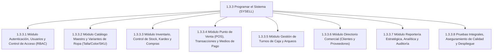

# Propuesta de EDT Optimizada y Diccionario de Trabajo (V2.0)
## Fase de Construcción y Programación del Sistema (Cuenta de Control 1.3.3)

> **Proyecto:** SYSELL — Sistema Web de Gestión de Inventario y Ventas  
> **Metodología:** Híbrida RUP + Scrum  
> **Arquitectura:** Clean Architecture + CQRS  
> **Equipo:** Pollitos Design  
> **Fecha:** Octubre 2026  

---

## 1. Estructura Jerárquica de la EDT Optimizada (WBS 1.3.3)

Para subsanar las omisiones de la versión legacy y alinear el trabajo a los 18 Requisitos Funcionales (`RF-01` al `RF-18`), se reestructura la cuenta de control **`1.3.3 Programar el sistema`** en **8 paquetes de trabajo especializados**:

---

## 2. Diccionario de la EDT (WBS Dictionary) — Especificación Detallada

A continuación se detalla cada paquete de trabajo, definiendo objetivos, descripción técnica bajo Clean Architecture + CQRS, actividades concretas, responsables según el Working Agreement, entregables y criterios de aceptación medibles.

---

### Paquete de Trabajo: 1.3.3.1
**Nombre:** Módulo de Autenticación, Usuarios y Control de Acceso (RBAC)  
**Cuenta de Control Padre:** 1.3.3 Programar el sistema  
**Requisitos Trazables:** `RF-01`, `RF-02`, `RNF-01`, `RNF-02`  
**Épica Relacionada:** `EP-01 Seguridad y Control de Acceso`  

* **Objetivo:** Implementar la infraestructura de seguridad, autenticación basada en tokens JWT y autorización granular por roles (Administrador y Vendedor) con políticas estrictas de sesión.
* **Descripción Técnica:**
  - *Dominio:* Entidades `Usuario`, `Rol`, `Permiso` y Value Objects (`Email`, `PasswordHash`).
  - *Aplicación:* `LoginCommand`, `LogoutCommand`, `RefreshTokenCommand`, `GetUsuarioProfileQuery`.
  - *Infraestructura:* Hasheo con algoritmos seguros (Argon2 / BCrypt), emisión y validación de JWT, middleware de autenticación HTTP.
  - *Presentación:* Pantalla de Login responsiva, interceptores de sesión en frontend y protección de rutas.
* **Actividades Clave:**
  1. Diseñar entidades de dominio y contratos de repositorio de usuarios y roles.
  2. Implementar servicio de generación/validación de tokens JWT con claims de rol.
  3. Desarrollar vistas web para formulario de login con validación de credenciales en tiempo real.
  4. Implementar políticas de cierre de sesión por inactividad y renovación segura de token.
* **Asignación de Roles:**
  - *Responsable (R):* Aron Cachicatari (Desarrollador Full-Stack)
  - *Aprueba (A):* Johan Mamani (Jefe de Proyecto / Líder Técnico)
  - *Apoya / Revisa (C/I):* Pierrette Chávez (Scrum Master), Alex Chata (QA)
* **Criterios de Aceptación (DoD):**
  - Autenticación exitosa genera token JWT con tiempo de expiración configurado.
  - El sistema bloquea el acceso a rutas protegidas cuando el usuario no cuenta con el rol requerido (HTTP 401 / 403).
  - Passwords almacenadas con cifrado irreversible y salt individual.
  - Cobertura de pruebas unitarias en Dominio y Aplicación ≥ 80%.

---

### Paquete de Trabajo: 1.3.3.2
**Nombre:** Módulo de Catálogo Maestro y Variantes de Ropa (Talla/Color/SKU)  
**Cuenta de Control Padre:** 1.3.3 Programar el sistema  
**Requisitos Trazables:** `RF-03`, `RF-04`, `RF-05`  
**Épica Relacionada:** `EP-02 Catálogo y Productos`  

* **Objetivo:** Desarrollar el subsistema de gestión de prendas con categorización jerárquica, marcas comerciales, variantes multi-dimensión (Talla, Color, Código SKU único y Código de Barras) y políticas de precios.
* **Descripción Técnica:**
  - *Dominio:* Agregado `Producto`, entidad `VarianteProducto`, `Categoria`, `Marca`, `PrecioVenta`.
  - *Aplicación:* Commands: `CrearProductoCommand`, `ActualizarProductoCommand`, `CambiarPrecioCommand`. Queries: `GetCatalogoQuery`, `GetProductoByIdQuery`, `BuscarProductosFiltroQuery`.
  - *Infraestructura:* Repositorios mapeados contra tablas `productos`, `variantes_producto`, `categorias`, `marcas`.
  - *Presentación:* Catálogo web con galería, modal de gestión de variantes y buscador predictivo.
* **Actividades Clave:**
  1. Definir modelo de agregados de dominio para productos y variantes físicas.
  2. Crear CRUD de categorías y marcas maestras con validación de nombres únicos.
  3. Implementar lógica de generación/validación de SKU y código de barras único por variante.
  4. Desarrollar interfaz visual para registro de productos con formulario dinámico de tallas y colores.
* **Asignación de Roles:**
  - *Responsable (R):* Aron Cachicatari (Developer)
  - *Diseño UI / UX (C):* Luis Condori (Diseñador / Analista Funcional)
  - *Aprueba / Revisa (A):* Johan Mamani
* **Criterios de Aceptación (DoD):**
  - Permite crear un producto base y generar múltiples variantes por combinación de talla y color.
  - No permite SKUs duplicados a nivel de base de datos ni a nivel de dominio.
  - Filtro por categoría, marca y término de búsqueda responde en menos de 1 segundo.

---

### Paquete de Trabajo: 1.3.3.3
**Nombre:** Módulo de Inventario, Control de Stock, Kardex y Compras  
**Cuenta de Control Padre:** 1.3.3 Programar el sistema  
**Requisitos Trazables:** `RF-06`, `RF-07`, `RF-08`, `RNF-04`  
**Épica Relacionada:** `EP-03 Inventario y Kardex`  

* **Objetivo:** Construir la lógica de control cuantitativo de stock por almacén/tienda, registro inmutable de movimientos en Kardex (entradas, salidas, mermas, traslados) y órdenes de abastecimiento con proveedores.
* **Descripción Técnica:**
  - *Dominio:* Agregado `Inventario`, `MovimientoKardex`, `OrdenCompra`, `DetalleOrdenCompra`.
  - *Aplicación:* `RegistrarEntradaStockCommand`, `RegistrarAjusteInventarioCommand`, `CrearOrdenCompraCommand`, `GetStockPorVarianteQuery`, `GetKardexHistoricoQuery`.
  - *Infraestructura:* Control de transacciones atómicas (ACID) y bloqueos pesimistas/optimistas para prevenir condiciones de carrera en stock.
  - *Presentación:* Tablero de inventario con semáforos de stock bajo, módulo de ajuste y visor de Kardex.
* **Actividades Clave:**
  1. Implementar servicio de dominio para cálculo de saldos en Kardex por método promedio ponderado / FIFO.
  2. Desarrollar transacción atómica de actualización de stock ante compras y ajustes manuales auditados.
  3. Crear interfaz para emisión y recepción de órdenes de compra a proveedores.
  4. Configurar alertas visuales automáticas cuando el stock sea menor o igual al stock mínimo configurado.
* **Asignación de Roles:**
  - *Responsable (R):* Aron Cachicatari (Developer)
  - *QA & Testing (R):* Alex Chata (Analista QA)
  - *Aprueba (A):* Johan Mamani
* **Criterios de Aceptación (DoD):**
  - Cada modificación de stock genera una fila inmutable en la tabla de Kardex con tipo, motivo, usuario y fecha.
  - El sistema impide registrar stock negativo bajo cualquier circunstancia.
  - Alerta visible en tiempo real para productos en quiebre de stock.

---

### Paquete de Trabajo: 1.3.3.4
**Nombre:** Módulo Punto de Venta (POS), Transacciones y Medios de Pago  
**Cuenta de Control Padre:** 1.3.3 Programar el sistema  
**Requisitos Trazables:** `RF-09`, `RF-10`, `RF-11`, `RF-12`, `RNF-03`  
**Épica Relacionada:** `EP-04 Punto de Venta (POS)`  

* **Objetivo:** Desarrollar la interfaz rápida de venta en caja (POS) con soporte para lectura de códigos de barras, selección de prendas, liquidación multitendencia (Efectivo, Yape, Plin, Tarjeta), emisión de comprobante y anulación controlada.
* **Descripción Técnica:**
  - *Dominio:* Agregado `Venta`, entidad `DetalleVenta`, entidad `PagoVenta`, Value Object `MontoDinero`.
  - *Aplicación:* `RegistrarVentaCommand`, `AnularVentaCommand`, `GetVentaByIdQuery`, `ListarVentasDiaQuery`.
  - *Infraestructura:* Transacción integral que: (1) registra cabecera y detalle de venta, (2) descuenta stock de variantes, (3) inserta salida en Kardex, (4) registra desglose de medios de pago, (5) valida contra turno de caja activo.
  - *Presentación:* Pantalla POS de alta velocidad, modal de cobro mixto, cálculo automático de vuelto y generador de ticket imprimible (PDF / térmica).
* **Actividades Clave:**
  1. Diseñar el flujo de venta de un solo clic con atajos de teclado y búsqueda instantánea.
  2. Implementar validación estricta de pagos mixtos (la suma de pagos debe coincidir exactamente con el total de venta).
  3. Desarrollar la anulación de ventas con restitución automática e inmediata de stock en Kardex.
  4. Generar plantilla imprimible de boleta/ticket con desglose de impuestos (IGV) y datos de la tienda.
* **Asignación de Roles:**
  - *Responsable (R):* Aron Cachicatari (Developer)
  - *Diseño UI / UX (C):* Luis Condori
  - *QA & Validación (R):* Alex Chata
  - *Aprueba (A):* Johan Mamani
* **Criterios de Aceptación (DoD):**
  - Registro de venta completa (hasta emisión de ticket) completado en menos de 5 segundos.
  - Descuento de stock instantáneo y reflejado en el inventario general.
  - Soporte comprobado para transacciones combinadas (ej: 50% Efectivo, 50% Yape).
  - La anulación devuelve el stock íntegramente al inventario registrando motivo y usuario que autorizó.

---

### Paquete de Trabajo: 1.3.3.5
**Nombre:** Módulo de Gestión de Turnos de Caja y Arqueos  
**Cuenta de Control Padre:** 1.3.3 Programar el sistema  
**Requisitos Trazables:** `RF-13`, `RF-14`  
**Épica Relacionada:** `EP-05 Caja y Arqueo`  

* **Objetivo:** Construir el control de flujo de caja física: apertura con monto inicial, registro de ingresos/egresos menores auditados, cierre de turno y cuadre de caja (arqueo ciego) calculando sobrantes o faltantes.
* **Descripción Técnica:**
  - *Dominio:* Entidad `CajaTurno`, `MovimientoCaja`.
  - *Aplicación:* `AbrirCajaCommand`, `CerrarCajaCommand`, `RegistrarMovimientoCajaCommand`, `GetEstadoCajaActualQuery`.
  - *Infraestructura:* Reglas de negocio que impiden vender si no existe una caja abierta para el usuario/sucursal en curso.
  - *Presentación:* Modal de apertura matutina, panel de movimientos del turno y pantalla de arqueo final con resumen comparativo.
* **Actividades Clave:**
  1. Implementar bloqueo del módulo POS si el usuario logueado no posee un turno de caja activo.
  2. Desarrollar registro de entradas y salidas de efectivo extraordinarias (ej. pago de delivery, retiro de sencillo).
  3. Crear pantalla de cierre de caja con cálculo de efectivo esperado vs. efectivo real contado por el cajero.
  4. Generar reporte consolidado de cierre de turno en formato imprimible.
* **Asignación de Roles:**
  - *Responsable (R):* Aron Cachicatari
  - *QA (R):* Alex Chata
  - *Aprueba (A):* Johan Mamani
* **Criterios de Aceptación (DoD):**
  - No es posible realizar ninguna venta en el sistema si la caja está cerrada.
  - El sistema calcula con precisión de dos decimales la diferencia (sobrante o faltante) al cierre del turno.
  - Todo movimiento de egreso exige descripción obligatoria y comprobante de respaldo.

---

### Paquete de Trabajo: 1.3.3.6
**Nombre:** Módulo de Directorio Comercial (Clientes y Proveedores)  
**Cuenta de Control Padre:** 1.3.3 Programar el sistema  
**Requisitos Trazables:** `RF-15`, `RF-16`  
**Épica Relacionada:** `EP-06 Directorio Comercial`  

* **Objetivo:** Desarrollar los catálogos de terceros comerciales (clientes habituales para fidelización y proveedores para órdenes de compra), validando identificación tributaria (DNI / RUC).
* **Descripción Técnica:**
  - *Dominio:* Entidades `Cliente` y `Proveedor` con Value Objects de validación de documento (DNI de 8 dígitos, RUC de 11 dígitos).
  - *Aplicación:* Commands: `CrearClienteCommand`, `CrearProveedorCommand`, `ActualizarClienteCommand`. Queries: `BuscarClientePorDocQuery`, `ListarProveedoresQuery`.
  - *Infraestructura:* Búsqueda indexada y validación de unicidad de documento de identidad.
  - *Presentación:* Vistas de gestión comercial y búsqueda rápida integrada directamente en el modal del POS.
* **Actividades Clave:**
  1. Desarrollar entidades y reglas de negocio para DNI, RUC y teléfono.
  2. Implementar búsqueda rápida de clientes en pantalla de venta sin interrumpir el flujo del cajero.
  3. Crear mantenimiento de proveedores con historial de órdenes de compra vinculadas.
* **Asignación de Roles:**
  - *Responsable (R):* Aron Cachicatari
  - *Analista Funcional (C):* Luis Condori
  - *Aprueba (A):* Johan Mamani
* **Criterios de Aceptación (DoD):**
  - Validación de formato DNI (8 dígitos numéricos) y RUC (11 dígitos).
  - Creación rápida de cliente desde el POS en menos de 3 clics.
  - Historial de compras consultable por cliente.

---

### Paquete de Trabajo: 1.3.3.7
**Nombre:** Módulo de Reportería Estratégica, Analítica y Auditoría  
**Cuenta de Control Padre:** 1.3.3 Programar el sistema  
**Requisitos Trazables:** `RF-17`, `RF-18`, `RNF-05`  
**Épica Relacionada:** `EP-07 Analítica y Auditoría`  

* **Objetivo:** Proveer a la gerencia dashboards analíticos interactivos (ventas por periodo, prendas más vendidas por talla/color, rentabilidad bruta, rotación de inventario) y un registro inmutable de auditoría para operaciones críticas.
* **Descripción Técnica:**
  - *Dominio:* Especificación de métricas analíticas y entidad `LogAuditoria`.
  - *Aplicación:* Queries CQRS de lectura altamente optimizadas (`GetReporteVentasPorFechaQuery`, `GetTopPrendasVendidasQuery`, `GetAuditoriaOperacionesQuery`).
  - *Infraestructura:* Consultas SQL agregadas con índices estratégicos en fechas y claves foráneas; exportadores de datos (Excel / CSV / PDF).
  - *Presentación:* Dashboard gráfico interactivo (gráficos de barras y líneas) y filtros de fecha dinámicos.
* **Actividades Clave:**
  1. Diseñar queries especializadas de solo lectura evitando bloqueos en la base de datos transaccional.
  2. Implementar gráficos de tendencias de venta diaria, semanal y mensual.
  3. Desarrollar middleware de auditoría que capture automáticamente: IP, fecha, usuario, acción y estado previo/nuevo en operaciones críticas.
  4. Habilitar exportación de reportes a formatos estándar de oficina.
* **Asignación de Roles:**
  - *Responsable (R):* Aron Cachicatari
  - *Diseño Dashboard (C):* Luis Condori
  - *Aprueba (A):* Johan Mamani
* **Criterios de Aceptación (DoD):**
  - Generación de reportes de hasta 10,000 transacciones en menos de 2 segundos.
  - Registro automático en bitácora de auditoría ante: anulaciones de venta, ajustes de stock y cambios de precio.
  - Descarga correcta de archivos Excel/PDF con datos formateados.

---

### Paquete de Trabajo: 1.3.3.8
**Nombre:** Pruebas Integrales, Aseguramiento de Calidad y Despliegue  
**Cuenta de Control Padre:** 1.3.3 Programar el sistema  
**Requisitos Trazables:** `RNF-01` al `RNF-06`, Criterios DoD  
**Épica Relacionada:** `Transversal / Hardening & DevOps`  

* **Objetivo:** Ejecutar la suite integral de pruebas unitarias, de integración y end-to-end (E2E), verificar el cumplimiento de los estándares de Clean Architecture y ejecutar el empaquetado y despliegue continuo en el entorno VPS institucional.
* **Descripción Técnica:**
  - *QA & Testing:* Pruebas automatizadas de APIs, pruebas de UI sobre navegadores modernos (Chrome, Firefox, Edge, Safari), pruebas de concurrencia y carga básica.
  - *DevOps:* Configuración de contenedorización / scripts de despliegue, configuración de variables de entorno seguras y optimización de assets frontend.
* **Actividades Clave:**
  1. Ejecutar batería de pruebas de regresión en cada incremento funcional.
  2. Auditar cumplimiento de Clean Architecture (verificar que Dominio no tenga dependencias externas).
  3. Realizar pruebas de aceptación con usuarios reales (UAT) siguiendo escenarios de uso cotidianos.
  4. Configurar servidor de producción, base de datos MySQL de producción y certificado SSL.
* **Asignación de Roles:**
  - *Responsable QA (R):* Alex Chata
  - *Responsable Despliegue (R):* Aron Cachicatari
  - *Coordinación UAT (F):* Pierrette Chávez
  - *Aprobación Final (A):* Johan Mamani
* **Criterios de Aceptación (DoD):**
  - 100% de casos de prueba críticos ejecutados con resultado exitoso.
  - 0 bugs de severidad Crítica o Alta abiertos.
  - Despliegue funcional en VPS institucional accesible mediante HTTPS con rendimiento óptimo.
