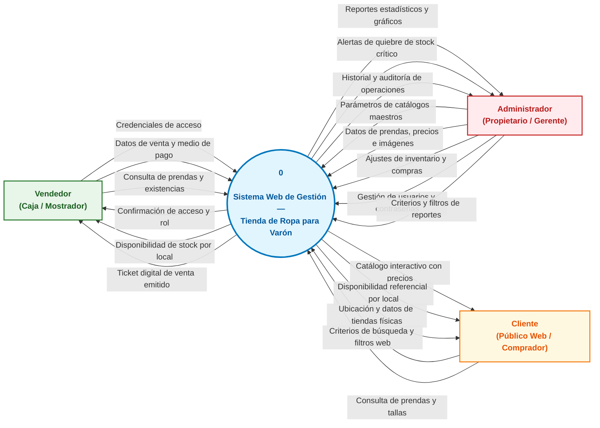
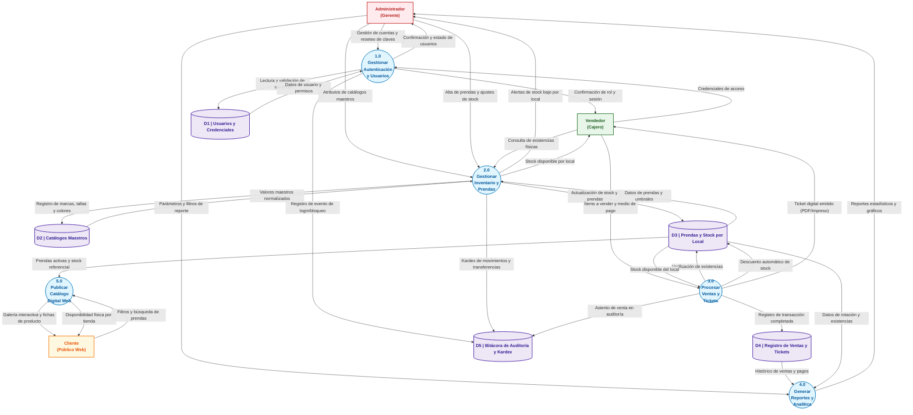
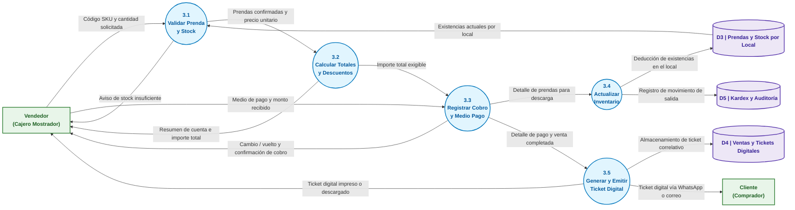

# Especificación de Diagramas de Flujo de Datos (DFD)

**Proyecto:** Sistema de Gestión — Tienda de Ropa para Varón  
**Versión:** 2.0  
**Fecha:** 13/10/2026  

---

## 📌 1. Marco Metodológico y Elementos del DFD

Un **Diagrama de Flujo de Datos (DFD)** es una herramienta de modelado estructurado que representa cómo se mueve, transforma y almacena la información dentro de un sistema.

A diferencia del **Caso de Uso** (que modela *quién interactúa con qué pantalla para lograr una meta*), el **DFD** se concentra en:
> **Entidad Externa ➔ Proceso (Transformación) ⇄ Flujo de Datos ⇄ Almacén de Datos**

### 1.1 Elementos Notacionales (Gane & Sarson / Yourdon)

| Símbolo | Elemento | Definición en el Sistema |
|:---:|---|---|
| 🟩 | **Entidad Externa** | Persona u organización externa al software que envía datos de entrada o recibe resultados del sistema (*Vendedor, Administrador, Cliente*). |
| 🔵 | **Proceso** | Función o rutina del software que transforma datos de entrada en datos de salida mediante reglas de negocio. |
| ➔ | **Flujo de Datos** | Tubería o movimiento de información entre procesos, entidades y almacenes. **Siempre se nombra con un sustantivo**. |
| 🗄️ | **Almacén de Datos (D1, D2...)** | Repositorio pasivo donde los datos se guardan para su uso posterior (tablas de la base de datos). |

### 1.2 Reglas Básicas Cumplidas en este Modelo
1. **Regla de Nomenclatura:** Todos los flujos tienen nombres sustantivos (ej. *"Datos de venta"*, no verbos como *"Vender"*).
2. **Conservación de Información:** Ningún proceso puede ser un "agujero negro" (solo recibir datos sin emitir) ni un "milagro" (solo emitir datos de la nada).
3. **No comunicación directa entre entidades:** Dos actores externos nunca se comunican directamente a través del DFD.
4. **No comunicación directa entre almacenes:** Dos almacenes de datos nunca se transfieren datos directamente sin que medie un proceso.
5. **Consistencia y Balanceo entre Niveles:** Todas las entradas y salidas del Nivel 0 se mantienen de forma balanceada en el Nivel 1.

---

## 🛰️ 2. DFD Nivel 0 (Diagrama de Contexto)

El **Nivel 0** delimita la frontera del sistema: muestra al software completo como un **único proceso central (Proceso 0)** interactuando exclusivamente con las entidades externas.

### Tabla de Balanceo del Nivel 0 (Entradas y Salidas)

| Entidad Externa | Flujos de Datos que Envía (Entradas al Sistema) | Flujos de Datos que Recibe (Salidas del Sistema) |
|---|---|---|
| **Vendedor** | • Credenciales de acceso • Consulta de prendas y existencias • Datos de venta y medio de pago | • Confirmación de acceso y rol • Disponibilidad de stock por local • Ticket digital de venta emitido |
| **Administrador** | • Gestión de usuarios y contraseñas • Parámetros de catálogos maestros • Datos de prendas, precios e imágenes • Ajustes de inventario y compras • Criterios y filtros de reportes | • Alertas de quiebre de stock crítico • Reportes estadísticos y gráficos • Historial y auditoría de operaciones |
| **Cliente (Web)** | • Criterios de búsqueda y filtros web • Consulta de prendas y tallas | • Catálogo interactivo con precios • Disponibilidad referencial por local • Ubicación y datos de tiendas físicas |

---

## 🏙️ 3. DFD Nivel 1 (Procesos Principales del Sistema)

El **Nivel 1** descompone el Proceso 0 en sus **5 procesos fundamentales** y formaliza los **5 almacenes de datos ($D1$ a $D5$)** que dan soporte a las transacciones de la tienda.

### Diccionario de Almacenes de Datos (D1 a D5)

| Código | Nombre del Almacén | Contenido de Datos Almacenados | Tablas Físicas de la BD |
|:---:|---|---|---|
| **D1** | **Usuarios y Credenciales** | Cuentas de acceso, nombres, roles (Admin/Vendedor), hashes bcrypt de contraseñas, estado (Activo/Inactivo/Bloqueado) y contador de intentos. | `usuarios`, `roles`, `intentos_login` |
| **D2** | **Catálogos Maestros** | Atributos fijos normalizados administrados por el dueño: categorías, tallas numéricas y alfabéticas, catálogo de colores con código HEX y marcas. | `categorias`, `tallas`, `colores`, `marcas` |
| **D3** | **Prendas y Stock por Local** | Ficha técnica de prendas (código SKU, nombre, descripción, precio compra, precio venta, foto) y tabla de existencias independientes para **Local 1** y **Local 2** con umbral mínimo. | `prendas`, `inventario_local`, `sucursales` |
| **D4** | **Registro de Ventas y Tickets** | Encabezado de transacciones (número correlativo de ticket, fecha/hora, cajero, local, medio de pago, totales) y líneas de detalle de prendas vendidas. | `ventas`, `detalle_ventas`, `tickets_digitales` |
| **D5** | **Bitácora de Auditoría y Kardex** | Historial inmutable de movimientos de inventario (ingresos, traslados entre sedes, mermas) y auditoría de accesos al sistema con dirección IP y fecha. | `kardex_movimientos`, `auditoria_sistema` |

---

## 🏠 4. DFD Nivel 2 (Descomposición del Proceso 3.0: Procesar Ventas y Tickets)

Siguiendo el estándar de las láminas académicas, el **Nivel 2** le aplica un zoom de máximo detalle al **proceso núcleo del negocio**: la venta en mostrador, descomponiéndolo en sus 5 subprocesos (`3.1` a `3.5`).

### Detalle de Subprocesos del Nivel 2

1. **P3.1 — Validar Prenda y Stock:** Recibe el SKU leído por escáner o teclado, consulta en tiempo real el almacén `D3` filtrando por el local del vendedor. Si el stock es inferior al pedido, emite un aviso al vendedor; si es suficiente, transfiere el artículo confirmado y su precio al cálculo de totales.
2. **P3.2 — Calcular Totales y Descuentos:** Agrupa las líneas de venta, aplica promociones autorizadas y calcula el Subtotal, Descuentos e Importe Total a pagar en soles, mostrándoselo al cajero y pasando el monto neto al cobro.
3. **P3.3 — Registrar Cobro y Medio de Pago:** Captura el método de pago (Efectivo, Tarjeta, Yape/Plin), calcula el vuelto a entregar al cliente y confirma la aprobación económica de la venta.
4. **P3.4 — Actualizar Inventario y Kardex:** Realiza la deducción atómica de las existencias vendidas en el almacén `D3` correspondiente al local físico y asienta la salida por venta en la bitácora `D5`.
5. **P3.5 — Generar y Emitir Ticket Digital:** Asigna número de serie único interno, almacena el comprobante en `D4` y despacha el ticket para impresión térmica, descarga en PDF o envío instantáneo al cliente por WhatsApp.

---

## 🔗 5. Matriz de Trazabilidad: DFD vs. Requisitos Funcionales

| Proceso DFD | Nombre del Proceso | Requisitos Funcionales que Implementa |
|:---:|---|---|
| **1.0** | Gestionar Autenticación y Usuarios | RF-01, RF-02, RF-03, RF-04, RF-05, RF-06, RF-07, RF-08, RF-09, RF-10, RF-11, RF-12, RF-13, RF-14, RF-73 |
| **2.0** | Gestionar Inventario y Prendas | RF-15, RF-16, RF-17, RF-18, RF-19, RF-20, RF-22, RF-23, RF-24, RF-25, RF-26 a RF-34, RF-35 a RF-39, RF-74, RF-75, RF-77 |
| **3.0** | Procesar Ventas y Tickets | RF-21, RF-40, RF-41, RF-42, RF-43, RF-44, RF-45, RF-46, RF-47, RF-48, RF-49, RF-50, RF-51, RF-52, RF-53, RF-54, RF-55, RF-76 |
| **4.0** | Generar Reportes y Analítica | RF-56, RF-57, RF-58, RF-59, RF-60, RF-61, RF-62, RF-63, RF-64, RF-65, RF-66 |
| **5.0** | Publicar Catálogo Digital Web | RF-67, RF-68, RF-69, RF-70, RF-71, RF-72 |
