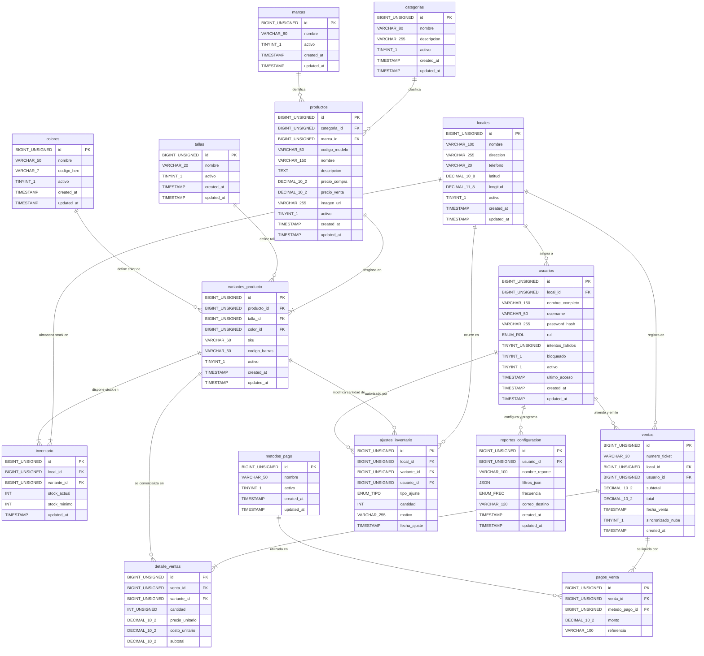

# Documentación Técnica de Base de Datos (MySQL)

**Proyecto:** Sistema de Gestión — Tienda de Ropa para Varón  
**Versión:** 2.0  
**Motor de Base de Datos:** MySQL 8.0 (InnoDB)  
**Fecha:** 13/10/2026  

---

## 1. Planteamiento de Entidades

A continuación se listan las entidades del sistema agrupadas por su responsabilidad funcional, alineadas al modelo de 2 locales físicos, control estricto de catálogos maestros y tickets digitales sin SUNAT.

### 🏢 Entidades Principales
1. **`locales` (Sucursales / Tiendas Físicas):** Representa cada uno de los dos establecimientos comerciales físicos del negocio donde se custodia inventario y se realizan ventas.
2. **`usuarios` (Personal del Sistema):** Representa las cuentas de acceso del personal autenticado (Administrador y Vendedores), gestionando credenciales, roles y estados de bloqueo.
3. **`productos` (Prendas Genéricas):** Representa la definición conceptual de una prenda de ropa (nombre base, descripción general, código base, precio de venta y costo referencial).
4. **`variantes_producto` (SKU Específico):** Representa el producto concreto y vendible derivado de la combinación única de prenda, talla y color, identificado con su propio código de barras / SKU.
5. **`inventario` (Existencias por Tienda):** Controla la cantidad física real de cada variante en cada uno de los locales, gestionando el stock actual y el umbral de stock mínimo para alertas.
6. **`ventas` (Cabecera de Transacción):** Registra la operación de venta finalizada, asociando el local, el vendedor responsable, el número correlativo de ticket digital, fecha/hora y los montos totales.
7. **`detalle_ventas` (Ítems Vendidos):** Contiene el desglose de productos comercializados en cada venta, guardando cantidades, precios unitarios y subtotales históricos congelados.
8. **`pagos_venta` (Desglose de Medios de Pago):** Registra los medios de pago monetarios (efectivo, Yape, Plin, tarjeta) utilizados para liquidar una venta, permitiendo pagos combinados.

### 🏷️ Entidades Secundarias y Catálogos Maestros
9. **`categorias` (Catálogo Maestro):** Clasificación jerárquica de las prendas (ej. Polos, Camisas, Pantalones, Casacas, Bermudas, Accesorios).
10. **`marcas` (Catálogo Maestro):** Marcas comerciales asociadas a las prendas.
11. **`tallas` (Catálogo Maestro):** Lista estandarizada de tallas disponibles (ej. S, M, L, XL, 28, 30, 32, 34).
12. **`colores` (Catálogo Maestro):** Lista estandarizada de colores comerciales disponibles para las prendas.
13. **`metodos_pago` (Catálogo Maestro):** Listado de opciones de pago habilitadas en caja (Efectivo, Yape, Plin, Tarjeta Débito/Crédito, Transferencia).
14. **`ajustes_inventario` (Auditoría de Stock):** Registra variaciones manuales de stock efectuadas exclusivamente por el Administrador (ingresos de mercadería, mermas o correcciones de conteo físico).
15. **`reportes_configuracion` (Preferencias de Reportes):** Almacena configuraciones de filtros guardadas por el Administrador para consultas y envíos programados.

---

## 2. Diccionario de Datos (Detalle de Tablas y Atributos)

### 2.1 Tabla: `locales`
Almacena la información de las dos tiendas físicas del negocio.

| Nombre del Atributo | Tipo de Dato | Claves | Nulabilidad | Descripción y Propósito |
|---|---|---|---|---|
| `id` | `BIGINT UNSIGNED AUTO_INCREMENT` | PK | NOT NULL | Identificador único del local comercial. |
| `nombre` | `VARCHAR(100)` | Unique | NOT NULL | Nombre comercial del establecimiento (ej. "Local 1 - Centro", "Local 2 - Mall"). |
| `direccion` | `VARCHAR(255)` | - | NOT NULL | Dirección física exacta del local. |
| `telefono` | `VARCHAR(20)` | - | NULL | Teléfono o celular de contacto de la tienda. |
| `latitud` | `DECIMAL(10, 8)` | - | NULL | Coordenada de latitud para visualización en mapa web del catálogo. |
| `longitud` | `DECIMAL(11, 8)` | - | NULL | Coordenada de longitud para visualización en mapa web del catálogo. |
| `activo` | `TINYINT(1)` | - | NOT NULL | Estado operativo del local (1: Activo, 0: Inactivo). Default `1`. |
| `created_at` | `TIMESTAMP` | - | NOT NULL | Fecha y hora de registro del local en el sistema. |
| `updated_at` | `TIMESTAMP` | - | NOT NULL | Fecha y hora de última modificación de los datos del local. |

---

### 2.2 Tabla: `usuarios`
Gestiona las cuentas de acceso al sistema con roles y mecanismos de seguridad ante bloqueos.

| Nombre del Atributo | Tipo de Dato | Claves | Nulabilidad | Descripción y Propósito |
|---|---|---|---|---|
| `id` | `BIGINT UNSIGNED AUTO_INCREMENT` | PK | NOT NULL | Identificador único del usuario. |
| `local_id` | `BIGINT UNSIGNED` | FK | NULL | Local habitual o asignado al usuario (NULL si es Administrador global). |
| `nombre_completo` | `VARCHAR(150)` | - | NOT NULL | Nombre y apellidos completos del empleado o administrador. |
| `username` | `VARCHAR(50)` | Unique | NOT NULL | Nombre de usuario único para autenticación en el sistema. |
| `password_hash` | `VARCHAR(255)` | - | NOT NULL | Hash cifrado de la contraseña (utilizando algoritmos seguros como Bcrypt/Argon2). |
| `rol` | `ENUM('ADMINISTRADOR', 'VENDEDOR')` | - | NOT NULL | Perfil de acceso al sistema con permisos diferenciados. |
| `intentos_fallidos` | `TINYINT UNSIGNED` | - | NOT NULL | Contador de intentos fallidos consecutivos de login. Default `0`. |
| `bloqueado` | `TINYINT(1)` | - | NOT NULL | Indica si la cuenta se encuentra bloqueada por seguridad (1: Sí, 0: No). Default `0`. |
| `activo` | `TINYINT(1)` | - | NOT NULL | Indica si el usuario está habilitado para operar (1: Activo, 0: Inactivo). Default `1`. |
| `ultimo_acceso` | `TIMESTAMP` | - | NULL | Fecha y hora del último inicio de sesión exitoso. |
| `created_at` | `TIMESTAMP` | - | NOT NULL | Fecha y hora de creación de la cuenta. |
| `updated_at` | `TIMESTAMP` | - | NOT NULL | Fecha y hora de última actualización del registro o contraseña. |

---

### 2.3 Tabla: `categorias` (Catálogo Maestro)
Categorías de prendas administradas por el Administrador.

| Nombre del Atributo | Tipo de Dato | Claves | Nulabilidad | Descripción y Propósito |
|---|---|---|---|---|
| `id` | `BIGINT UNSIGNED AUTO_INCREMENT` | PK | NOT NULL | Identificador único de la categoría. |
| `nombre` | `VARCHAR(80)` | Unique | NOT NULL | Nombre de la categoría (ej. "Polos", "Camisas", "Pantalones"). |
| `descripcion` | `VARCHAR(255)` | - | NULL | Detalle o nota descriptiva de la categoría. |
| `activo` | `TINYINT(1)` | - | NOT NULL | Estado del catálogo (1: Activo, 0: Inactivo). Default `1`. |
| `created_at` | `TIMESTAMP` | - | NOT NULL | Fecha y hora de creación. |
| `updated_at` | `TIMESTAMP` | - | NOT NULL | Fecha y hora de última modificación. |

---

### 2.4 Tabla: `marcas` (Catálogo Maestro)
Marcas comerciales administradas por el Administrador.

| Nombre del Atributo | Tipo de Dato | Claves | Nulabilidad | Descripción y Propósito |
|---|---|---|---|---|
| `id` | `BIGINT UNSIGNED AUTO_INCREMENT` | PK | NOT NULL | Identificador único de la marca comercial. |
| `nombre` | `VARCHAR(80)` | Unique | NOT NULL | Nombre de la marca registrada (ej. "Levis", "Polo Ralph", "Zara Man"). |
| `activo` | `TINYINT(1)` | - | NOT NULL | Estado del catálogo (1: Activa, 0: Inactiva). Default `1`. |
| `created_at` | `TIMESTAMP` | - | NOT NULL | Fecha y hora de creación. |
| `updated_at` | `TIMESTAMP` | - | NOT NULL | Fecha y hora de última modificación. |

---

### 2.5 Tabla: `tallas` (Catálogo Maestro)
Tallas disponibles administradas por el Administrador.

| Nombre del Atributo | Tipo de Dato | Claves | Nulabilidad | Descripción y Propósito |
|---|---|---|---|---|
| `id` | `BIGINT UNSIGNED AUTO_INCREMENT` | PK | NOT NULL | Identificador único de la talla. |
| `nombre` | `VARCHAR(20)` | Unique | NOT NULL | Denominación de la talla (ej. "S", "M", "L", "XL", "28", "30", "32"). |
| `activo` | `TINYINT(1)` | - | NOT NULL | Estado del catálogo (1: Activa, 0: Inactiva). Default `1`. |
| `created_at` | `TIMESTAMP` | - | NOT NULL | Fecha y hora de creación. |
| `updated_at` | `TIMESTAMP` | - | NOT NULL | Fecha y hora de última modificación. |

---

### 2.6 Tabla: `colores` (Catálogo Maestro)
Colores estandarizados administrados por el Administrador.

| Nombre del Atributo | Tipo de Dato | Claves | Nulabilidad | Descripción y Propósito |
|---|---|---|---|---|
| `id` | `BIGINT UNSIGNED AUTO_INCREMENT` | PK | NOT NULL | Identificador único del color. |
| `nombre` | `VARCHAR(50)` | Unique | NOT NULL | Nombre del color (ej. "Negro", "Blanco", "Azul Marino", "Verde Militar"). |
| `codigo_hex` | `VARCHAR(7)` | - | NULL | Código hexadecimal de color para la interfaz visual web (ej. `#000000`). |
| `activo` | `TINYINT(1)` | - | NOT NULL | Estado del catálogo (1: Activo, 0: Inactivo). Default `1`. |
| `created_at` | `TIMESTAMP` | - | NOT NULL | Fecha y hora de creación. |
| `updated_at` | `TIMESTAMP` | - | NOT NULL | Fecha y hora de última modificación. |

---

### 2.7 Tabla: `metodos_pago` (Catálogo Maestro)
Opciones de pago disponibles en las ventas.

| Nombre del Atributo | Tipo de Dato | Claves | Nulabilidad | Descripción y Propósito |
|---|---|---|---|---|
| `id` | `BIGINT UNSIGNED AUTO_INCREMENT` | PK | NOT NULL | Identificador único del método de pago. |
| `nombre` | `VARCHAR(50)` | Unique | NOT NULL | Nombre del medio (ej. "Efectivo", "Yape", "Plin", "Tarjeta Débito", "Tarjeta Crédito"). |
| `activo` | `TINYINT(1)` | - | NOT NULL | Estado del método (1: Habilitado, 0: Deshabilitado). Default `1`. |
| `created_at` | `TIMESTAMP` | - | NOT NULL | Fecha y hora de registro. |
| `updated_at` | `TIMESTAMP` | - | NOT NULL | Fecha y hora de última modificación. |

---

### 2.8 Tabla: `productos`
Definición de las prendas y sus características generales.

| Nombre del Atributo | Tipo de Dato | Claves | Nulabilidad | Descripción y Propósito |
|---|---|---|---|---|
| `id` | `BIGINT UNSIGNED AUTO_INCREMENT` | PK | NOT NULL | Identificador único del producto. |
| `categoria_id` | `BIGINT UNSIGNED` | FK | NOT NULL | Categoría a la que pertenece la prenda. |
| `marca_id` | `BIGINT UNSIGNED` | FK | NOT NULL | Marca comercial asociada a la prenda. |
| `codigo_modelo` | `VARCHAR(50)` | Unique | NOT NULL | Código interno o de referencia del modelo de prenda. |
| `nombre` | `VARCHAR(150)` | - | NOT NULL | Nombre descriptivo y comercial de la prenda. |
| `descripcion` | `TEXT` | - | NULL | Descripción detallada para la ficha técnica del catálogo digital. |
| `precio_compra` | `DECIMAL(10, 2)` | - | NOT NULL | Costo unitario referencial de adquisición para cálculo de ganancias netas. |
| `precio_venta` | `DECIMAL(10, 2)` | - | NOT NULL | Precio de venta oficial al público en moneda local (Soles). |
| `imagen_url` | `VARCHAR(255)` | - | NULL | URL o ruta de la fotografía principal de la prenda para el catálogo digital. |
| `activo` | `TINYINT(1)` | - | NOT NULL | Estado del producto (1: Disponible, 0: Descontinuado/Inactivo). Default `1`. |
| `created_at` | `TIMESTAMP` | - | NOT NULL | Fecha y hora de creación del producto. |
| `updated_at` | `TIMESTAMP` | - | NOT NULL | Fecha y hora de última modificación. |

---

### 2.9 Tabla: `variantes_producto`
Instancia física vendible de un producto combinando talla y color específico.

| Nombre del Atributo | Tipo de Dato | Claves | Nulabilidad | Descripción y Propósito |
|---|---|---|---|---|
| `id` | `BIGINT UNSIGNED AUTO_INCREMENT` | PK | NOT NULL | Identificador único de la variante. |
| `producto_id` | `BIGINT UNSIGNED` | FK | NOT NULL | Producto base al que pertenece la variante. |
| `talla_id` | `BIGINT UNSIGNED` | FK | NOT NULL | Talla asignada a la variante. |
| `color_id` | `BIGINT UNSIGNED` | FK | NOT NULL | Color asignado a la variante. |
| `sku` | `VARCHAR(60)` | Unique | NOT NULL | Código SKU único asignado a la combinación exacta de prenda, talla y color. |
| `codigo_barras` | `VARCHAR(60)` | Unique | NULL | Código de barras estándar para lectura con lector óptico en caja. |
| `activo` | `TINYINT(1)` | - | NOT NULL | Estado de la variante (1: Activa, 0: Inactiva). Default `1`. |
| `created_at` | `TIMESTAMP` | - | NOT NULL | Fecha y hora de creación de la variante. |
| `updated_at` | `TIMESTAMP` | - | NOT NULL | Fecha y hora de última modificación. |

*Restricción Unique Compuesta:* `(producto_id, talla_id, color_id)` para impedir variantes duplicadas.

---

### 2.10 Tabla: `inventario`
Control de existencias físicas en cada uno de los dos locales.

| Nombre del Atributo | Tipo de Dato | Claves | Nulabilidad | Descripción y Propósito |
|---|---|---|---|---|
| `id` | `BIGINT UNSIGNED AUTO_INCREMENT` | PK | NOT NULL | Identificador único del registro de inventario. |
| `local_id` | `BIGINT UNSIGNED` | FK | NOT NULL | Local físico donde se almacena el stock. |
| `variante_id` | `BIGINT UNSIGNED` | FK | NOT NULL | Variante específica del producto. |
| `stock_actual` | `INT` | - | NOT NULL | Cantidad de unidades físicas disponibles en tienda. Default `0`. |
| `stock_minimo` | `INT` | - | NOT NULL | Umbral de stock mínimo para disparar alertas de reposición. Default `5`. |
| `updated_at` | `TIMESTAMP` | - | NOT NULL | Fecha y hora de última actualización del conteo de stock. |

*Restricción Unique Compuesta:* `(local_id, variante_id)` para asegurar un solo registro de conteo por variante en cada local.

---

### 2.11 Tabla: `ventas`
Encabezado de cada transacción comercial realizada en punto de venta.

| Nombre del Atributo | Tipo de Dato | Claves | Nulabilidad | Descripción y Propósito |
|---|---|---|---|---|
| `id` | `BIGINT UNSIGNED AUTO_INCREMENT` | PK | NOT NULL | Identificador único de la transacción de venta. |
| `numero_ticket` | `VARCHAR(30)` | Unique | NOT NULL | Número correlativo único del ticket digital (ej. `TICK-L1-00000452`). |
| `local_id` | `BIGINT UNSIGNED` | FK | NOT NULL | Local comercial donde se efectuó la venta. |
| `usuario_id` | `BIGINT UNSIGNED` | FK | NOT NULL | Vendedor o Administrador autenticado que registró la venta. |
| `subtotal` | `DECIMAL(10, 2)` | - | NOT NULL | Monto acumulado de los productos sin incluir cargos adicionales. |
| `total` | `DECIMAL(10, 2)` | - | NOT NULL | Importe monetario total cancelado por el cliente. |
| `fecha_venta` | `TIMESTAMP` | - | NOT NULL | Fecha y hora exacta en que se confirmó la transacción. |
| `sincronizado_nube`| `TINYINT(1)` | - | NOT NULL | Indicador de sincronización nube (1: Sincronizado, 0: Pendiente offline). Default `1`. |
| `created_at` | `TIMESTAMP` | - | NOT NULL | Fecha y hora de inserción del registro en la base de datos. |

---

### 2.12 Tabla: `detalle_ventas`
Desglose de cada ítem incluido en una venta.

| Nombre del Atributo | Tipo de Dato | Claves | Nulabilidad | Descripción y Propósito |
|---|---|---|---|---|
| `id` | `BIGINT UNSIGNED AUTO_INCREMENT` | PK | NOT NULL | Identificador único del renglón de detalle. |
| `venta_id` | `BIGINT UNSIGNED` | FK | NOT NULL | Venta a la que pertenece el ítem. |
| `variante_id` | `BIGINT UNSIGNED` | FK | NOT NULL | Variante de prenda vendida. |
| `cantidad` | `INT UNSIGNED` | - | NOT NULL | Número de unidades vendidas de la variante. |
| `precio_unitario` | `DECIMAL(10, 2)` | - | NOT NULL | Precio de venta unitario histórico al momento de la transacción. |
| `costo_unitario` | `DECIMAL(10, 2)` | - | NOT NULL | Costo de adquisición unitario histórico para cálculo exacto de ganancias netas. |
| `subtotal` | `DECIMAL(10, 2)` | - | NOT NULL | Subtotal calculado (`cantidad * precio_unitario`). |

---

### 2.13 Tabla: `pagos_venta`
Medios de pago aplicados a cada venta (soporta pagos divididos).

| Nombre del Atributo | Tipo de Dato | Claves | Nulabilidad | Descripción y Propósito |
|---|---|---|---|---|
| `id` | `BIGINT UNSIGNED AUTO_INCREMENT` | PK | NOT NULL | Identificador único del pago. |
| `venta_id` | `BIGINT UNSIGNED` | FK | NOT NULL | Venta a la que se abona el monto. |
| `metodo_pago_id` | `BIGINT UNSIGNED` | FK | NOT NULL | Método de pago utilizado (Efectivo, Yape, Plin, Tarjeta). |
| `monto` | `DECIMAL(10, 2)` | - | NOT NULL | Importe abonado con este medio de pago específico. |
| `referencia` | `VARCHAR(100)` | - | NULL | Código de operación o número de referencia bancaria/billetera (opcional). |

---

### 2.14 Tabla: `ajustes_inventario`
Auditoría y trazabilidad de ajustes manuales de stock efectuados por el Administrador.

| Nombre del Atributo | Tipo de Dato |  Claves | Nulabilidad | Descripción y Propósito |
|---|---|---|---|---|
| `id` | `BIGINT UNSIGNED AUTO_INCREMENT` | PK | NOT NULL | Identificador único del ajuste de stock. |
| `local_id` | `BIGINT UNSIGNED` | FK | NOT NULL | Local donde se realizó la corrección física de stock. |
| `variante_id` | `BIGINT UNSIGNED` | FK | NOT NULL | Variante de producto modificada. |
| `usuario_id` | `BIGINT UNSIGNED` | FK | NOT NULL | Administrador responsable que autorizó y ejecutó el ajuste. |
| `tipo_ajuste` | `ENUM('INGRESO', 'SALIDA_MERMA', 'CORRECCION')` | - | NOT NULL | Causal técnica del ajuste de existencias. |
| `cantidad` | `INT` | - | NOT NULL | Cantidad de unidades ajustadas (+ o -). |
| `motivo` | `VARCHAR(255)` | - | NOT NULL | Justificación obligatoria del ajuste para auditoría interna. |
| `fecha_ajuste` | `TIMESTAMP` | - | NOT NULL | Fecha y hora en que se ejecutó el ajuste. |

---

### 2.15 Tabla: `reportes_configuracion`
Configuraciones y programaciones de reportes guardadas por el Administrador.

| Nombre del Atributo | Tipo de Dato | Claves | Nulabilidad | Descripción y Propósito |
|---|---|---|---|---|
| `id` | `BIGINT UNSIGNED AUTO_INCREMENT` | PK | NOT NULL | Identificador único de la configuración. |
| `usuario_id` | `BIGINT UNSIGNED` | FK | NOT NULL | Administrador propietario de la configuración. |
| `nombre_reporte` | `VARCHAR(100)` | - | NOT NULL | Nombre personalizado asignado al reporte guardado. |
| `filtros_json` | `JSON` | - | NOT NULL | Parámetros y filtros estructurados (fechas, sucursal, categorías, métodos). |
| `frecuencia` | `ENUM('MANUAL', 'SEMANAL', 'MENSUAL')` | - | NOT NULL | Tipo de programación automática. Default `'MANUAL'`. |
| `correo_destino` | `VARCHAR(120)` | - | NULL | Correo electrónico receptor en caso de envíos programados. |
| `created_at` | `TIMESTAMP` | - | NOT NULL | Fecha de creación de la configuración. |
| `updated_at` | `TIMESTAMP` | - | NOT NULL | Fecha de última edición. |

---

## 3. Definición de Relaciones

A continuación se detallan todas las relaciones de integridad referencial entre las tablas del modelo:

| Tabla Origen | Cardinalidad | Tabla Destino | Llave Foránea (FK) | Regla / Descripción de la Relación |
|---|---|---|---|---|
| `locales` | **1 : N** | `usuarios` | `usuarios.local_id` -> `locales.id` | Un local puede tener asignados múltiples vendedores; un vendedor pertenece a un local (o ninguno si es Admin general). `ON DELETE SET NULL`. |
| `categorias` | **1 : N** | `productos` | `productos.categoria_id` -> `categorias.id` | Una categoría agrupa múltiples prendas; una prenda pertenece a una categoría maestra. `ON DELETE RESTRICT`. |
| `marcas` | **1 : N** | `productos` | `productos.marca_id` -> `marcas.id` | Una marca abarca múltiples prendas; cada prenda pertenece a una marca comercial. `ON DELETE RESTRICT`. |
| `productos` | **1 : N** | `variantes_producto` | `variantes_producto.producto_id` -> `productos.id` | Una prenda base genera múltiples variantes de color y talla; una variante pertenece a una sola prenda. `ON DELETE CASCADE`. |
| `tallas` | **1 : N** | `variantes_producto` | `variantes_producto.talla_id` -> `tallas.id` | Una talla del catálogo maestro está presente en múltiples variantes. `ON DELETE RESTRICT`. |
| `colores` | **1 : N** | `variantes_producto` | `variantes_producto.color_id` -> `colores.id` | Un color del catálogo maestro está presente en múltiples variantes. `ON DELETE RESTRICT`. |
| `locales` | **1 : N** | `inventario` | `inventario.local_id` -> `locales.id` | Un local físico almacena registros de inventario para sus variantes disponibles. `ON DELETE CASCADE`. |
| `variantes_producto` | **1 : N** | `inventario` | `inventario.variante_id` -> `variantes_producto.id` | Una variante de producto tiene un registro de existencias en cada uno de los locales. `ON DELETE CASCADE`. |
| `locales` | **1 : N** | `ventas` | `ventas.local_id` -> `locales.id` | Un local comercial registra múltiples ventas; una venta se origina en un local determinado. `ON DELETE RESTRICT`. |
| `usuarios` | **1 : N** | `ventas` | `ventas.usuario_id` -> `usuarios.id` | Un usuario (vendedor/admin) emite múltiples ventas; cada venta queda auditada con su creador. `ON DELETE RESTRICT`. |
| `ventas` | **1 : N** | `detalle_ventas` | `detalle_ventas.venta_id` -> `ventas.id` | Una venta contiene uno o varios ítems vendidos; cada ítem pertenece a una venta única. `ON DELETE CASCADE`. |
| `variantes_producto` | **1 : N** | `detalle_ventas` | `detalle_ventas.variante_id` -> `variantes_producto.id` | Una variante puede ser comercializada en múltiples detalles de venta. `ON DELETE RESTRICT`. |
| `ventas` | **1 : N** | `pagos_venta` | `pagos_venta.venta_id` -> `ventas.id` | Una venta puede cancelarse con uno o más métodos de pago combinados. `ON DELETE CASCADE`. |
| `metodos_pago` | **1 : N** | `pagos_venta` | `pagos_venta.metodo_pago_id` -> `metodos_pago.id` | Un método de pago maestro se utiliza en múltiples pagos de ventas. `ON DELETE RESTRICT`. |
| `locales` | **1 : N** | `ajustes_inventario` | `ajustes_inventario.local_id` -> `locales.id` | Un local recibe múltiples ajustes manuales de stock auditados. `ON DELETE RESTRICT`. |
| `variantes_producto` | **1 : N** | `ajustes_inventario` | `ajustes_inventario.variante_id` -> `variantes_producto.id` | Una variante puede tener historial de ajustes de stock. `ON DELETE RESTRICT`. |
| `usuarios` | **1 : N** | `ajustes_inventario` | `ajustes_inventario.usuario_id` -> `usuarios.id` | El Administrador que autorizó el ajuste queda registrado para auditoría. `ON DELETE RESTRICT`. |
| `usuarios` | **1 : N** | `reportes_configuracion` | `reportes_configuracion.usuario_id` -> `usuarios.id` | Un usuario Administrador puede guardar y programar múltiples reportes personalizados. `ON DELETE CASCADE`. |

---

## 4. Diagrama Entidad-Relación (Mermaid ER)

El siguiente diagrama modela de forma gráfica las 15 tablas transaccionales y sus relaciones de cardinalidad bajo la Tercera Forma Normal (3FN):

