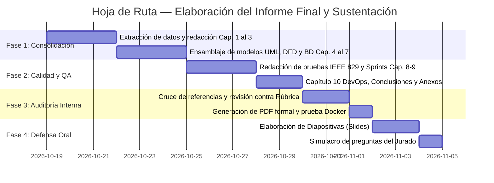

# 📘 BASES, FORMATO Y GUÍA MAESTRA PARA LA ESTRUCTURA DEL INFORME FINAL (RÚBRICA ESIS - UNJBG)

**Proyecto:** Sistema de Gestión Comercial — Tienda de Ropa para Varón (**SYSELL Web v2.0**)  
**Cliente Comercial:** Tienda de Indumentaria Masculina *Machi's* (Tacna, Perú)  
**Asignatura:** Ingeniería de Software I / Análisis de Sistemas (Periodo Académico 2026-II)  
**Escuela Profesional:** Escuela Profesional de Ingeniería en Informática y Sistemas (ESIS)  
**Universidad:** Universidad Nacional Jorge Basadre Grohmann (UNJBG)  
**Equipo de Desarrollo:** Pollitos Design  
- **Johan Mamani:** Product Owner / Jefe de Proyecto  
- **Aron Cachicatari:** Tech Lead / Arquitecto de Software  
- **Luis Condori:** Diseñador UI/UX / Analista de Sistemas  
- **Giorgini Disalvatore:** QA Lead / Scrum Master  

---

## 📌 1. Presentación y Propósito del Documento

El presente documento establece las **bases conceptuales, el formato estandarizado y la estructura capitular definitiva** para la redacción del **Informe Final del Proyecto**, diseñado para garantizar la máxima calificación (**20 / 20 — Nivel Excelente**) según la **Rúbrica de Evaluación Oficial de la ESIS** (`RUBRICA_EVALUACION_EXPO_FINAL_IS_ESIS.xlsx`).

Este formato articula de forma armónica e incremental:
1. **Los antecedentes del curso previo (Análisis de Sistemas):** El diagnóstico crítico del informe legacy (*Trabajo Final II*), la EDT clásica PMBOK, los requisitos preliminares y los vacíos funcionales detectados.
2. **Las nuevas implementaciones de Ingeniería de Software (v2.0):** El desarrollo metodológico capa por capa, desde la ingeniería de requisitos rigurosa, modelos UML y DFD, diseño dinámico de secuencia, arquitectura limpia (Clean Architecture + CQRS), base de datos relacional normalizada, suite IEEE 829 de pruebas, gestión ágil de 4 Sprints, hasta la infraestructura DevOps con Docker y CI.

---

## 📊 2. Matriz de Mapeo: Rúbrica Oficial (27 Criterios) vs. Artefactos del Repositorio

La siguiente matriz desglosa cómo cada uno de los 27 criterios de la rúbrica de evaluación está respaldado por artefactos técnicos específicos en el repositorio:

| N° | Categoría Rúbrica | Criterio de Evaluación Oficial | Artefacto(s) en Repositorio que lo Respalda | Capítulo del Informe Final |
|:---:|---|---|---|:---:|
| **1** | Proceso y Ciclo de Vida | Contexto, alcance, objetivo e identificación del **MVP heredado de Análisis de Sistemas**. | [`docs/legacy_v1.0/`](legacy_v1.0/), [`docs/analisis_edt/analisis_critico_edt_legacy.md`](analisis_edt/analisis_critico_edt_legacy.md) | **Capítulo 1** |
| **2** | Proceso y Ciclo de Vida | Explicación del **proceso de software adoptado**, actividades, roles, entradas, salidas y artefactos. | [`docs/acuerdos/acuerdo_trabajo_equipo.md`](acuerdos/acuerdo_trabajo_equipo.md), [`docs/estandares_arquitectura/`](estandares_arquitectura/) | **Capítulo 2** |
| **3** | Proceso y Ciclo de Vida | Mapeo formal a las **áreas pertinentes de SWEBOK v4** y justificación de su aplicación. | Justificación en estándares de arquitectura y ciclo de vida de requisitos. | **Capítulo 2** |
| **4** | Proceso y Ciclo de Vida | Selección y justificación del **ciclo de vida y estrategia de desarrollo** (Híbrido RUP + Scrum). | [`docs/sprints/planificacion_sprints.md`](sprints/planificacion_sprints.md) (Sección 1) | **Capítulo 2** |
| **5** | Proceso y Ciclo de Vida | Representación del **flujo del proceso** verificable (planificación, desarrollo, revisión, entrega). | Sincronización RUP (Inicio, Elaboración, Construcción, Transición) con Sprints 1 a 4. | **Capítulo 2 y 9** |
| **6** | Proceso y Ciclo de Vida | Requisitos claros, necesarios, no ambiguos y con **identificadores únicos**. | [`docs/requisitos_funcionales.md`](requisitos_funcionales.md) (`RF-01` a `RF-77` oficiales). | **Capítulo 3** |
| **7** | Proceso y Ciclo de Vida | Contraste de **versiones/fuentes** (v1.0 vs. v2.0), supuestos y dudas resueltas. | [`README.md`](../README.md) (Sección comparativa), [`INFORME_ANALISIS_Y_MEJORAS.md`](../INFORME_ANALISIS_Y_MEJORAS.md) | **Capítulo 1 y 3** |
| **8** | Proceso y Ciclo de Vida | Documento ordenado, **trazable a fuentes**, con redacción y citas claras. | Matriz de trazabilidad integral e hipervínculos bidireccionales en Markdown. | **Capítulo 3 y 11** |
| **9** | Medición y Mejora | Roles, responsabilidades y **Working Agreement** con evidencia formal. | [`docs/acuerdos/acuerdo_trabajo_equipo.md`](acuerdos/acuerdo_trabajo_equipo.md) (Firmas, ceremonias y RACI). | **Capítulo 2** |
| **10** | Medición y Mejora | Criterios de **Definition of Ready (DoR) y Definition of Done (DoD)** coherentes. | [`docs/product_backlog/product_backlog.md`](product_backlog/product_backlog.md) (Secciones 1.1 y 1.2). | **Capítulo 9** |
| **11** | Medición y Mejora | Modelos pertinentes (**DFD y UML**) correctos y consistentes entre sí. | [`docs/diagramas_dfd/`](diagramas_dfd/), [`docs/diagramas_casos_de_uso/`](diagramas_casos_de_uso/), [`docs/diagramas_secuencia/`](diagramas_secuencia/) | **Capítulos 4 y 5** |
| **12** | Medición y Mejora | Especificación funcional con identificador, actor, condición, resultado y **criterios verificables**. | Plantilla estándar de cada RF en [`docs/requisitos_funcionales.md`](requisitos_funcionales.md). | **Capítulo 3** |
| **13** | Medición y Mejora | Criterios de calidad y prioridad (**MoSCoW**), resolución de duplicidades. | Clasificación Must/Should/Could en HUs y priorización Alta/Media en RFs. | **Capítulo 3 y 9** |
| **14** | Medición y Mejora | Relación **Necesidad → Requisito → Modelo → Criterio de Aceptación**. | [`docs/matriz_de_trazabilidad.md`](matriz_de_trazabilidad.md) (Matriz integral de 7 columnas). | **Capítulo 3** |
| **15** | Medición y Mejora | Organización conforme a **ISO/IEC/IEEE 29148** y pruebas **IEEE 829**. | Formato formal de requisitos y [`docs/casos_de_prueba.md`](casos_de_prueba.md) (`CP-01` a `CP-77`). | **Capítulos 3 y 8** |
| **16** | Medición y Mejora | Trazabilidad entre objetivos, actividades, artefactos, tareas y evidencias. | [`docs/analisis_edt/propuesta_edt_optimizada.md`](analisis_edt/propuesta_edt_optimizada.md) y tasks de sprints. | **Capítulo 9** |
| **17** | Validación e Integración | Integración de catálogo, modelos, trazabilidad y especificación técnica. | Modelo integral unificado en el repositorio con navegación cruzada. | **Capítulo 10** |
| **18** | Validación e Integración | Entregables legibles, versionados y **pasos suficientes para replicar** el sistema. | [`docker-compose.yml`](../docker-compose.yml), [`database/schema.sql`](../database/schema.sql), [`database/seeds.sql`](../database/seeds.sql). | **Capítulo 7 y 10** |
| **19** | Validación e Integración | Declaración ética de herramientas/IA, verificación de resultados y citas. | Declaración metodológica de herramientas de modelado, testing y soporte. | **Capítulo 2 y 10** |
| **20** | Validación e Integración | Revisión de material estructurado en aula virtual y repositorio GitHub. | Repositorio GitHub versionado, con branches, tags y releases formales. | **Capítulo 10** |
| **21-27**| Sustentación Oral | Dominio conceptual, dicción, seguridad, tiempo, pensamiento crítico y slides. | Guía de defensa oral y banco de preguntas típicas de jurado. | **Sección 5 de esta guía** |

---

## 🏛️ 3. Estructura Capitular del Informe Final (Plantilla y Contenido Detallado)

El Informe Final de Ingeniería de Software debe redactarse siguiendo de manera rigurosa la siguiente estructura de **10 capítulos temáticos**:

```
INFORME FINAL DE INGENIERÍA DE SOFTWARE — SYSELL WEB v2.0
├── Portada Institucional y Metadatos
├── Índice General, Índice de Tablas e Índice de Figuras
├── Resumen Ejecutivo / Abstract
├── CAPÍTULO 1: Contexto, Diagnóstico del Sistema Heredado y Objetivos
├── CAPÍTULO 2: Marco Metodológico, SWEBOK v4 y Gobierno del Equipo
├── CAPÍTULO 3: Ingeniería de Requisitos (ISO/IEC/IEEE 29148) y Trazabilidad
├── CAPÍTULO 4: Modelado Funcional y Procesos del Negocio (UML y DFD)
├── CAPÍTULO 5: Diseño Dinámico e Interacción Técnica (PlantUML)
├── CAPÍTULO 6: Arquitectura del Software (Clean Architecture + CQRS + OWASP)
├── CAPÍTULO 7: Modelo de Datos Relacional (MySQL 8.0 en 3FN) e Infraestructura
├── CAPÍTULO 8: Plan de Aseguramiento de Calidad y Pruebas (IEEE 829)
├── CAPÍTULO 9: Gestión del Proyecto, Backlog Ágil y Ejecución de Sprints
├── CAPÍTULO 10: Despliegue, Validación Continua (CI/CD) y Conclusiones
├── Referencias Bibliográficas (IEEE / ISO)
└── Anexos Técnicos (Diccionario de BD, Scripts DDL, Actas de Reunión)
```

---

### Desglose Detallado de Cada Capítulo:

#### 📖 CAPÍTULO 1: Contexto, Diagnóstico del Sistema Heredado (Análisis de Sistemas) y Objetivos
1. **1.1. Información de la Empresa / Cliente:**
   - Denominación comercial: *Machi's* (Tacna, Perú). Tienda física de ropa para varón con 2 locales comerciales (Local 1: Av. San Martín N° 450, Local 2: Av. Bolognesi N° 820).
   - Problemática del negocio: Falta de visibilidad de existencias entre sucursales, discrepancias en inventario por texto libre en colores y tallas, ausencia de canal web de consulta y tickets manuales sin control interno.
2. **1.2. Diagnóstico Crítico del Sistema Heredado (Análisis de Sistemas - v1.0):**
   - Presentación de lo realizado en el curso previo (*Trabajo Final II*): WBS clásica PMBOK en 5 fases, cuenta de control `1.3.3 Programar el sistema`, 72 requisitos empíricos y DFDs preliminares.
   - **Deficiencias técnicas y metodológicas del proyecto heredado:**
     * *Atomización y confusión de nivel de abstracción:* En el curso previo, cada caja de texto o campo de formulario de pantalla se redactó como un "Requisito Funcional" independiente (ej. *RF-08: Pedir nombre de usuario*, *RF-09: Pedir contraseña*, *RF-10: Color de prenda*, *RF-11: Talla de prenda*). Esto infló artificialmente el catálogo a 72 requisitos superficiales sin lógica de negocio, validaciones transaccionales ni reglas de integridad.
     * *Vulnerabilidad crítica por texto libre (Ausencia de Catálogos Maestros):* Se permitía ingresar libremente cualquier texto para tallas ("M", "m", "Mediano", "med") o colores ("Azul", "Azul Marino", "Blue"), lo cual en producción corrompe la base de datos, imposibilita el cálculo de existencias y rompe los reportes estadísticos.
     * *Confusión tributaria (Riesgo SUNAT):* Se hablaba indistintamente de "boletas/facturas electrónicas", generando la falsa expectativa de integración con SUNAT/OSE, lo cual era inviable y desmedido para una tienda física minorista que requería exclusivamente **tickets digitales de control interno**.
     * *Vacíos transaccionales severos:* El sistema heredado omitió por completo el control de caja y turnos (apertura, arqueo ciego, cierre), la gestión de pagos mixtos (Efectivo + Yape/Plin), el control de mermas en Kardex y la anulación supervisada de ventas.
     * *Criterios de aceptación vagos:* Redactados como *"Se acepta cuando funcione sin errores"*, imposibilitando el testing formal y la verificabilidad objetiva.
     * *Monopolio operativo y error de codificación en la EDT:* Los 5 paquetes de trabajo fueron asignados a un único responsable con códigos erróneos (`1.3.1.1` a `1.3.1.5` en lugar de `1.3.3.X`), sin especialización de roles ni arquitectura en capas.
3. **1.3. Matriz de Transformación Integral: Análisis de Sistemas $\rightarrow$ Ingeniería de Software v2.0:**

| Capa de Ingeniería | Enfoque Heredado (Análisis de Sistemas v1.0) | Enfoque Refundado (Ingeniería de Software v2.0) | Criterio de Rúbrica Resuelto |
|---|---|---|:---:|
| **Elicitación y Requisitos** | 72 requisitos empíricos atomizados por campos de pantalla. | **77 Requisitos Funcionales Oficiales** bajo ISO/IEC/IEEE 29148 con descripción, actores, prioridad y criterios verificables. | Criterios 6, 7 y 12 |
| **Atributos de Calidad** | Requisitos no funcionales genéricos sin métricas verificables. | **14 Requisitos No Funcionales (RNF-01 a RNF-14)** categorizados según **ISO/IEC 25010** con métricas de tiempo y seguridad. | Criterios 6 y 15 |
| **Trazabilidad** | Inexistente. Requisitos huérfanos sin correspondencia a pruebas. | **Matriz de Trazabilidad Integral de 7 columnas** bidireccional (100% de cobertura verificada). | Criterios 8, 14 y 16 |
| **Modelado de Procesos** | DFDs conceptuales desconectados de las tablas de datos. | **DFD Niveles 0, 1 y 2 balanceados** con entradas, salidas y almacenes normalizados `D1` a `D5`. | Criterio 11 |
| **Modelado de Interacción** | Inexistente (cero diagramas de casos de uso formales). | **15 Casos de Uso UML 2.5** con especificaciones textuales completas (precondiciones, flujos alternos y postcondiciones). | Criterios 11 y 12 |
| **Diseño Dinámico** | Cero diagramas dinámicos de secuencia o colaboración. | **8 Diagramas de Secuencia Técnicos en PlantUML** (`strictuml`) modelando controladores, servicios y transacciones SQL ACID. | Criterios 11 y 16 |
| **Arquitectura de Software** | Estructura monolítica no definida; lógica mezclada con persistencia. | **Clean Architecture (4 capas concéntricas) + CQRS** con autenticación dual Laravel Sanctum (SPA Cookie + API Token). | Criterios 2, 3 y 4 |
| **Base de Datos** | Diseño empírico informal de tablas aisladas. | **17 Tablas relacionales en Tercera Forma Normal (3FN)** con script DDL `schema.sql` y datos semilla `seeds.sql`. | Criterios 11 y 18 |
| **Aseguramiento de Calidad** | "Se acepta si funciona sin errores" (subjetivo). | **77 Casos de Prueba IEEE 829 / ISTQB** con validación positiva, negativa y de límites. | Criterios 10 y 15 |
| **Gestión y Planificación** | EDT en cascada rígida con errores de jerarquía PMBOK. | **Marco Híbrido RUP + Scrum:** Product Backlog de 18 HUs (94 SP) en 4 Sprints quincenales con filtros DoR y DoD. | Criterios 4, 5, 9 y 10 |
| **Infraestructura y DevOps** | Despliegue manual no documentado. | **Docker Compose** (MySQL 8.0 + phpMyAdmin) y **CI en GitHub Actions** con linters y validación sintáctica. | Criterios 18 y 20 |

4. **1.4. Objetivos del Proyecto:**
   - *Objetivo General:* Diseñar e implementar un sistema web integral de gestión comercial, inventario multi-tienda y vitrina digital responsiva (SYSELL Web v2.0).
   - *Objetivos Específicos:* (1) Controlar existencias independientes y alertas de reposición por local; (2) Implementar terminal POS rápida con medios de pago mixtos; (3) Proporcionar vitrina pública en tiempo real; (4) Asegurar trazabilidad completa con auditoría y testing IEEE 829.

---

#### 📖 CAPÍTULO 2: Marco Metodológico, SWEBOK v4 y Gobierno del Equipo
1. **2.1. Selección y Justificación del Ciclo de Vida:**
   - **Enfoque Híbrido RUP + Scrum:** Justificación técnica de por qué se adopta RUP para la disciplina arquitectónica y de modelado (fases de Inicio, Elaboración, Construcción y Transición) y Scrum para la cadencia ágil y entregas de valor en 4 Sprints quincenales.
2. **2.2. Mapeo a las Áreas de Conocimiento de SWEBOK v4:**
   - *Software Requirements:* Elicitación, especificación y validación formal de requisitos funcionales y no funcionales.
   - *Software Design:* Arquitectura limpia en capas, CQRS, diagramas DFD y de secuencia UML.
   - *Software Construction:* Uso de PHP 8.2 (Laravel), React 18 (TypeScript), MySQL 8.0 e inyección de dependencias.
   - *Software Testing:* Diseño y ejecución de casos de prueba formales bajo estándar IEEE 829 / ISTQB.
   - *Software Engineering Management:* Planificación temporal, estimación con Planning Poker (Fibonacci) y gestión de riesgos.
   - *Software Engineering Process:* Mejora continua mediante Definition of Ready (DoR), Definition of Done (DoD) y retrospectivas.
3. **2.3. Acuerdos de Trabajo del Equipo (Working Agreement):**
   - Roles formales (PO, Tech Lead, UI/UX, QA), canales de comunicación oficial, políticas de ramas en Git (GitFlow) y resolución de conflictos.

---

#### 📖 CAPÍTULO 3: Ingeniería de Requisitos (ISO/IEC/IEEE 29148) y Trazabilidad
1. **3.1. Proceso de Transformación y Refactorización de Requisitos:**
   - *El problema de los tres lenguajes:* Detallar cómo se resolvió la brecha donde la v1.0 tenía 72 requisitos de pantalla, mientras que los casos de prueba y la matriz utilizaban 77 requisitos profesionales.
   - *Metodología de consolidación:* Explicar cómo se agruparon los campos dispersos en agregados transaccionales coherentes (ej. la selección de prenda, talla, color, precio y SKU se consolidó en el agregado `RF-15: Registrar prenda con variantes`).
   - *Erradicación de campos libres (`RF-74`):* Demostrar cómo la creación de catálogos maestros cerrados eliminó el riesgo de datos corruptos.
2. **3.2. Necesidades del Negocio y del Usuario:**
   - Especificación formal de las 10 necesidades raíz (`N-01` a `N-10`).
3. **3.3. Catálogo Oficial de 77 Requisitos Funcionales (`RF-01` a `RF-77`):**
   - Presentación de los 5 módulos:
     * *Módulo 1:* Autenticación y Seguridad (15 RFs: login, bcrypt, bloqueo a 3 intentos, roles, usuarios, reset).
     * *Módulo 2:* Gestión de Inventario (28 RFs: prendas, variantes, stock por tienda, alertas, catálogos maestros cerrados).
     * *Módulo 3:* Registro y Punto de Venta POS (17 RFs: carrito, pagos mixtos, ticket digital, anulación Admin, modo offline).
     * *Módulo 4:* Reportes y Análisis Estratégico (11 RFs: ventas por fecha/local/vendedor, ranking top, gráficos, PDF/Excel).
     * *Módulo 5:* Catálogo Digital Web Público (6 RFs: vitrina sin login, filtros dinámicos, stock por tienda, responsive).
   - Estructura estándar de cada requisito: ID, Nombre, Descripción, Actor, Prioridad, Criterios de Aceptación Verificables y Trazabilidad.
4. **3.4. Requisitos No Funcionales y Criterios de Calidad (`RNF-01` a `RNF-14`):**
   - Atributos según ISO/IEC 25010: Rendimiento (tiempo de respuesta < 2s), Seguridad (OWASP, HTTPS, hashing Bcrypt), Fiabilidad (modo offline con sincronización), Usabilidad (Mobile-first).
5. **3.5. Matriz de Trazabilidad Integral (7 Columnas):**
   - Demostración de cobertura del 100%: Necesidad $\rightarrow$ RF $\rightarrow$ RNF $\rightarrow$ Caso de Uso $\rightarrow$ DFD $\rightarrow$ Diseño (DS / BD) $\rightarrow$ Caso de Prueba.

---

#### 📖 CAPÍTULO 4: Modelado Funcional y Procesos del Negocio (UML y DFD)
1. **4.1. Diagramas de Casos de Uso del Sistema (UML 2.5):**
   - Diagrama general del sistema y diagramas por módulo (`CU-01` a `CU-15`).
   - Especificación textual formal de cada caso de uso: Actores primarios/secundarios, precondiciones, flujo principal paso a paso, flujos alternos y postcondiciones.
2. **4.2. Diagramas de Flujo de Datos (DFD):**
   - *DFD Nivel 0 (Diagrama de Contexto):* Interacción del sistema con las entidades externas (Administrador, Vendedor, Cliente Web).
   - *DFD Nivel 1 (Procesos Principales):* Flujo entre los 5 procesos macro (`1.0 Autenticar`, `2.0 Gestionar Inventario`, `3.0 Procesar Ventas`, `4.0 Generar Reportes`, `5.0 Visualizar Catálogo`).
   - *DFD Nivel 2 (Subprocesos de Ventas):* Desglose transaccional (`3.1 Iniciar Venta`, `3.2 Cargar Ítems`, `3.3 Cobrar`, `3.4 Descontar Stock`, `3.5 Emitir Ticket`).
   - *Diccionario de Almacenes de Datos:* Mapeo formal de almacenes `D1` a `D5`.

---

#### 📖 CAPÍTULO 5: Diseño Dinámico e Interacción Técnica (PlantUML)
1. **5.1. Convenciones de Modelado de Secuencia:**
   - Adopción de PlantUML con estilo `strictuml` modelando la interacción a través de las 4 capas arquitectónicas.
2. **5.2. Suite de 8 Diagramas de Secuencia Técnicos:**
   - `DS-01`: Autenticación JWT y Bloqueo tras 3 intentos (`CU-01`).
   - `DS-02`: Registro de Prendas y Validación de Catálogos Cerrados (`CU-05`, `CU-07`).
   - `DS-03`: Transacción de Venta POS y Emisión de Ticket Digital (`CU-08`, `CU-09`).
   - `DS-04`: Ajuste de Inventario y Asiento en Kardex (`CU-06`).
   - `DS-05`: Generación y Exportación de Reportes en PDF/Excel (`CU-13`, `CU-14`).
   - `DS-06`: Gestión de Usuarios, Roles, Desbloqueo y Reseteo (`CU-02`).
   - `DS-07`: Consulta de Catálogo Digital Público y Stock Físico (`CU-15`).
   - `DS-08`: Anulación de Venta con Reversión Atómica de Stock (`CU-12`).

---

#### 📖 CAPÍTULO 6: Arquitectura del Software (Clean Architecture + CQRS + OWASP)
1. **6.1. Patrón Arquitectónico Base:**
   - Separación estricta en 4 capas concéntricas con regla de dependencia hacia adentro:
     * *Capa de Dominio:* Entidades puras de negocio (`Producto`, `Venta`, `Usuario`), Value Objects (`SKU`, `Dinero`) y reglas invariantes.
     * *Capa de Aplicación:* Casos de uso desacoplados organizados en **Commands** (mutaciones de estado) y **Queries** (lecturas optimizadas).
     * *Capa de Infraestructura:* Implementación de persistencia con Eloquent/MySQL, repositorios, servicios de tokens y almacenamiento de archivos.
     * *Capa de Presentación:* API RESTful en Laravel y cliente web SPA en React + TypeScript.
2. **6.2. Estándar de Seguridad y Autenticación Híbrida (OWASP Top 10):**
   - Implementación de **Laravel Sanctum**:
     * Modo SPA con Cookie HttpOnly, Secure, SameSite y protección CSRF para el navegador.
     * Modo API con Bearer Tokens para terminales de mostrador y sincronización offline.
   - Protección contra Inyección SQL (consultas parametrizadas) y Cross-Site Scripting (XSS).

---

#### 📖 CAPÍTULO 7: Modelo de Datos Relacional (MySQL 8.0 en 3FN) e Infraestructura
1. **7.1. Modelo Conceptual y Normalización:**
   - Justificación de la Tercera Forma Normal (3FN) eliminando redundancias en tallas, colores, marcas y transacciones.
2. **7.2. Diagrama Entidad-Relación (Mermaid ERD):**
   - Presentación de las **17 tablas relacionales** con cardinalidades, llaves primarias y foráneas.
3. **7.3. Diccionario Técnico de Datos:**
   - Tabla por tabla detallando atributos, tipos de datos, restricciones de nulabilidad y reglas de integridad en cascada.
4. **7.4. Scripts SQL Ejecutables y Datos Semilla:**
   - Referencia a [`database/schema.sql`](../database/schema.sql) y [`database/seeds.sql`](../database/seeds.sql).

---

#### 📖 CAPÍTULO 8: Plan de Aseguramiento de Calidad y Pruebas (IEEE 829 / ISTQB)
1. **8.1. Estrategia de Testing:**
   - Pruebas unitarias, de integración, de seguridad y de sistema.
2. **8.2. Suite de 77 Casos de Prueba (`CP-01` a `CP-77`):**
   - Presentación tabular por módulo con ID de prueba, RF asociado, precondiciones, pasos de ejecución y resultado esperado verificado.
   - Demostración de validación de criterios positivos, negativos y de límites (ej. bloqueo al 3er intento en `CP-06`, cálculo de vueltos en `CP-46`, anulación en `CP-53`).

---

#### 📖 CAPÍTULO 9: Gestión del Proyecto, Backlog Ágil y Ejecución de Sprints
1. **9.1. Product Backlog Priorizado:**
   - 18 Historias de Usuario estructuradas en 7 Épicas comerciales (`EP-01` a `EP-07`).
   - Criterios Definition of Ready (DoR) y Definition of Done (DoD).
2. **9.2. Planificación y Desglose de los 4 Sprints:**
   - Distribución de los 94 Story Points en el horizonte de 28 días:
     * *Sprint 1 (24 SP - Elaboración):* Arquitectura base, autenticación RBAC y catálogos maestros.
     * *Sprint 2 (24 SP - Construcción I):* Control de caja, arqueo ciego e inventario/Kardex.
     * *Sprint 3 (24 SP - Construcción II):* Terminal POS, pagos mixtos y emisión de tickets digitales.
     * *Sprint 4 (22 SP - Transición):* Reportería estratégica, bitácora de auditoría y vitrina web pública.
   - Desglose de tareas técnicas (`TSK`) por cada capa de Clean Architecture.
3. **9.3. Estructura de Desglose del Trabajo (EDT / WBS Optimizada):**
   - *Diagnóstico de la EDT heredada (Análisis de Sistemas):* Cuenta de control `1.3.3 Programar el sistema` desglosada erróneamente con prefijos `1.3.1.X`, repitiendo en cascada monolítica *"Diseñar BD $\rightarrow$ Programar $\rightarrow$ Probar"* para cada módulo aislado.
   - *Propuesta WBS optimizada v2.0:* Descomposición orientada a entregables de valor e incrementos funcionales (Sprints), organizando las tareas técnicas (`TSK`) verticalmente por caso de uso y horizontalmente por capa arquitectónica (Dominio, Aplicación, Infraestructura, Presentación y QA).
   - *Matriz de equivalencia WBS:* Cuadro comparativo entre los 5 paquetes legacy y los paquetes de trabajo modernos del diccionario de la EDT.

---

#### 📖 CAPÍTULO 10: Despliegue, Validación Continua (CI/CD) y Conclusiones
1. **10.1. Entorno de Despliegue Reproducible (Docker):**
   - Explicación del archivo [`docker-compose.yml`](../docker-compose.yml) (MySQL 8.0 y phpMyAdmin listos con un solo comando).
2. **10.2. Integración Continua (CI) en GitHub Actions:**
   - Automatización en [`.github/workflows/docs-validation.yml`](../.github/workflows/docs-validation.yml): validación sintáctica de PlantUML (`-checkonly`), Mermaid (`--no-sandbox`) y Markdown.
3. **10.3. Declaración Ética de Herramientas y Asistencia de IA:**
   - Declaración de uso transparente de herramientas de diagramación y modelos de IA como asistentes de formateo y revisión, con verificación humana de todo el código y artefactos.
4. **10.4. Conclusiones y Trabajo Futuro:**
   - Lecciones aprendidas, impacto en la tienda *Machi's* y hoja de ruta para la Fase 2 (pasarelas de pago online y facturación electrónica opcional).

---

## 🗺️ 4. Hoja de Ruta Paso a Paso para la Elaboración y Entrega del Informe

Para asegurar que el equipo cumpla con todos los estándares y fechas límites, se establece la siguiente ruta de trabajo estructurada en **4 fases operativas**:



### Paso a Paso Detallado:

#### Paso 1: Ensamblaje y Redacción de Secciones Base (Días 1–3)
- **Responsable:** Johan Mamani (PO) y Luis Condori (Analista).
- Tomar como base [`docs/requisitos_funcionales.md`](requisitos_funcionales.md), [`docs/necesidades_del_negocio.md`](necesidades_del_negocio.md) y [`docs/legacy_v1.0/`](legacy_v1.0/).
- Redactar el Capítulo 1 (contraste con Análisis de Sistemas) y Capítulo 3 (los 77 RFs y Matriz de 7 columnas).

#### Paso 2: Integración de Modelos Técnicos y Persistencia (Días 4–6)
- **Responsable:** Aron Cachicatari (Tech Lead) y Luis Condori.
- Consolidar los diagramas UML (`especificaciones_casos_de_uso.md`), DFDs (`documentacion_dfd.md`) y la suite de 8 diagramas de secuencia (`docs/diagramas_secuencia/`).
- Documentar el esquema de BD con las 17 tablas de [`docs/documentacion_tecnica_bd.md`](documentacion_tecnica_bd.md) y [`database/schema.sql`](../database/schema.sql).

#### Paso 3: Documentación de Pruebas, Sprints y DevOps (Días 7–9)
- **Responsable:** Giorgini Disalvatore (QA Lead) y Aron Cachicatari.
- Integrar la suite completa de los 77 Casos de Prueba IEEE 829 ([`docs/casos_de_prueba.md`](casos_de_prueba.md)).
- Documentar la planificación de los 4 Sprints ([`docs/sprints/planificacion_sprints.md`](sprints/planificacion_sprints.md)) y el despliegue con [`docker-compose.yml`](../docker-compose.yml).

#### Paso 4: Auditoría de Cumplimiento de la Rúbrica y Ensamblado Final (Días 10–11)
- **Responsable:** Todo el equipo (Revisión cruzada).
- Contrastar el documento completo contra los **27 criterios de la rúbrica oficial**.
- Compilar a documento formal PDF con carátula, membretes, numeración estándar e índices automáticos.

#### Paso 5: Preparación de la Defensa Oral y Simulacro (Días 12–13)
- Diseñar presentación en diapositivas con apoyo visual (evitando texto recargado).
- Realizar simulacro con el banco de preguntas típicas de sustentación (Sección 5).

---

## 🎯 5. Guía de Sustentación Oral y Preparación para el Jurado

Para alcanzar el puntaje máximo en los criterios de **Sustentación y Aspectos Generales (Criterios 21 al 27)**:

### 5.1. Distribución del Tiempo de Exposición (Total: 20–25 minutos)

| Bloque | Contenido de la Exposición | Expositor Sugerido | Tiempo |
|:---:|---|---|:---:|
| **1** | Contexto del negocio, cliente *Machi's*, diagnóstico del MVP heredado y objetivos | **Johan Mamani** (PO / Jefe de Proyecto) | 3 - 4 min |
| **2** | Proceso RUP + Scrum, SWEBOK v4, Working Agreement y 77 Requisitos Funcionales | **Luis Condori** (Analista / UI-UX) | 4 - 5 min |
| **3** | Arquitectura Clean + CQRS, DFDs, 8 Diagramas de Secuencia y Base de Datos (17 tablas) | **Aron Cachicatari** (Tech Lead / Arquitecto) | 5 - 6 min |
| **4** | Estrategia de Pruebas IEEE 829 (77 CPs), 4 Sprints, DoR/DoD y demo de Docker | **Giorgini Disalvatore** (QA Lead / Scrum Master) | 4 - 5 min |
| **5** | Conclusiones, lecciones aprendidas y ronda de preguntas del jurado | **Todo el equipo** | 5 - 6 min |

### 5.2. Banco de Preguntas Clave del Jurado y Respuestas Modelo

* **Pregunta 1: ¿Por qué cambiaron la especificación heredada de Análisis de Sistemas a la v2.0?**  
  * *Respuesta:* La v1.0 presentaba 72 requisitos empíricos centrados en campos de pantalla sin granularidad técnica, permitía texto libre en atributos críticos (tallas y colores) lo que corrompía la integridad de datos, y carecía de modelos dinámicos UML y control de turnos de caja. En la v2.0 se refundó el sistema bajo estándares formales (77 RFs con criterios de aceptación verificables, catálogos maestros cerrados y Clean Architecture).
* **Pregunta 2: ¿Cómo demuestran que el sistema satisface todas las necesidades del negocio?**  
  * *Respuesta:* A través de la **Matriz de Trazabilidad Integral de 7 columnas**, que vincula de manera bidireccional cada una de las 10 necesidades del negocio con sus requisitos funcionales, atributos de calidad RNF, casos de uso, procesos DFD, diagramas de secuencia, modelo relacional y sus respectivos casos de prueba IEEE 829.
* **Pregunta 3: ¿Por qué adoptaron Clean Architecture con CQRS en lugar de un MVC tradicional?**  
  * *Respuesta:* Para garantizar el desacoplamiento y la mantenibilidad a largo plazo. En una tienda de ropa con dos sucursales y sincronización offline, la lógica del dominio no debe depender del framework ni de la base de datos. CQRS separa los comandos transaccionales (como la confirmación de venta con descuento de stock atómico) de las consultas de alta concurrencia (como el catálogo web público), optimizando el rendimiento.
* **Pregunta 4: ¿Cómo manejan la seguridad ante ataques de fuerza bruta en el inicio de sesión?**  
  * *Respuesta:* Se unificó como estándar el bloqueo preventivo al **tercer (3er) intento fallido consecutivo**, almacenando el hash de contraseña con Bcrypt/Argon2. La cuenta pasa a estado bloqueado y solo el Administrador tiene privilegios para restablecerla (`RF-06`, `RF-14`, `CP-06`, `DS-01`).

---

*Guía técnica elaborada por el equipo de ingeniería de software — Pollitos Design, Octubre 2026.*
